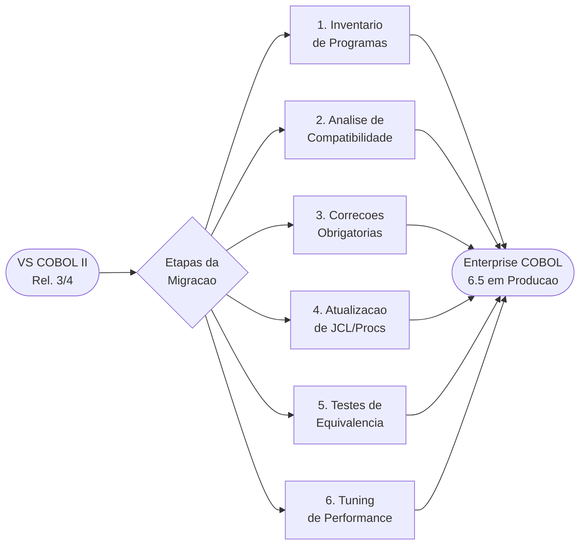

# Guia de Modernização: COBOL II → Enterprise COBOL 6.5

> **Skills especializados desta jornada:**
> | Skill | Tema |
> |---|---|
> | [`skill-lang-changes.md`](skill-lang-changes.md) | Mudancas de linguagem e sintaxe |
> | [`skill-compiler-options.md`](skill-compiler-options.md) | Opcoes de compilador |
> | [`skill-le-migration.md`](skill-le-migration.md) | Runtime: Language Environment |
> | [`skill-cics-migration.md`](skill-cics-migration.md) | CICS: translator e padroes |
> | [`skill-db2-migration.md`](skill-db2-migration.md) | DB2: coprocessor integrado |
> | [`skill-perf-modernization.md`](skill-perf-modernization.md) | Performance e otimizacao |
> | [`skill-jcl-procedures.md`](skill-jcl-procedures.md) | JCL e procedures de compilacao |

---

## Visao Geral da Jornada



---

## Etapa 1 — Inventario de Programas

Antes de qualquer mudanca de codigo, categorize cada programa segundo a
tabela de complexidade do Guia de Migracao (ref: `skill-migration-v65.md`
Ch.8 "Assigning complexity ratings"):

| Categoria | Atributos | Impacto |
|---|---|---|
| **Simples** | Sem CICS, sem DB2, sem CMPR2, sem features deprecadas | Recompilacao direta |
| **Medio** | Com CICS ou DB2, uso de CMPR2, opcoes obsoletas no JCL | Ajustes pontuais |
| **Complexo** | CMPR2 + features incompativeis + chamadas a IGZERRE/IGZETUN | Refatoracao de codigo |

**Ferramentas de apoio** (`skill-migration-v65.md` Appendix C):
- `FLAGMIG` — compilador flaga construtos incompativeis com Enterprise COBOL
- `FLAGMIG4` — flaga deprecacoes especificas para 6.x
- COBOL Conversion Aid (CCCA) — automatiza conversoes de codigo
- COBOL Upgrade Advisor for z/OS — analisa e prioriza aplicacoes

---

## Etapa 2 — Mapa de Decisao por Tipo de Programa

```
programa usa CMPR2?
  SIM -> verificar Table 26 em skill-migration-v65.md para diferencas CMPR2/NOCMPR2
         converter para NOCMPR2 antes de compilar com Enterprise COBOL
  NAO -> avancar para verificacao de sintaxe

programa usa CICS?
  SIM -> verificar skill-cics-migration.md
         - substituir DFHECP1$ por opcao CICS no compilador
         - revisar STOP RUN, CALL, HANDLE CONDITION

programa usa DB2?
  SIM -> verificar skill-db2-migration.md
         - substituir DSNHPC por opcao SQL no compilador
         - mover DECLARE CURSOR para DATA DIVISION

programa usa chamadas a runtime COBOL II (IGZERRE, IGZETUN, IGZCLOC)?
  SIM -> verificar skill-le-migration.md
         - substituir por chamadas LE equivalentes (CEE*)

JCL usa opcoes de compilador obsoletas (RES, NORES, SIZE, CMPR2)?
  SIM -> verificar skill-compiler-options.md e skill-jcl-procedures.md
```

---

## Etapa 3 — Resumo das Correcoes Obrigatorias

### 3.1 Linguagem

| # | Construto COBOL II | Acao em Enterprise COBOL 6.5 | Skill |
|---|---|---|---|
| L1 | `VALUE` em subordinados de `OCCURS` | Remover; usar `INITIALIZE` na Procedure Division | `skill-lang-changes.md` |
| L2 | `ACCEPT DATE / ACCEPT TIME` | Substituir por `FUNCTION CURRENT-DATE` ou `EXEC CICS ASKTIME` | `skill-lang-changes.md` |
| L3 | `ALTER` statement | Eliminar — nao suportado em NOCMPR2 | `skill-lang-changes.md` |
| L4 | `STOP literal` | Substituir por `DISPLAY` + `STOP RUN` | `skill-lang-changes.md` |
| L5 | `MOVE CORRESPONDING` com CMPR2 | Verificar semantica diferente em NOCMPR2 (Table 26) | `skill-lang-changes.md` |
| L6 | Palavras reservadas novas (JSON, UTF-8, etc.) | Renomear variaveis que conflitem com novas palavras reservadas | `skill-lang-changes.md` |

### 3.2 Compilador

| # | Opcao COBOL II | Acao | Skill |
|---|---|---|---|
| C1 | `RES` / `NORES` | Remover — eliminadas em EC 5+ | `skill-compiler-options.md` |
| C2 | `RESIDENT` | Remover — eliminada em EC 5+ | `skill-compiler-options.md` |
| C3 | `CMPR2` | Remover e converter programa para NOCMPR2 | `skill-compiler-options.md` |
| C4 | `SIZE` | Remover — eliminada em EC 5.2 | `skill-compiler-options.md` |
| C5 | `OPTIMIZE` | Atualizar para `OPT(FULL)` — novo padrao em 6.x | `skill-compiler-options.md` |
| C6 | `NUMPROC(PFD)` | Substituir por `INVDATA` para controle fino de dados invalidos | `skill-compiler-options.md` |
| C7 | `TEST` | Usar `TEST(DWARF,SEPARATE)` para debug sem overhead de producao | `skill-compiler-options.md` |

### 3.3 Runtime / Language Environment

| # | Construto COBOL II | Acao | Skill |
|---|---|---|---|
| R1 | `CALL 'IGZERRE'` | Substituir por `CALL 'CEEPIPI'` (LE callable service) | `skill-le-migration.md` |
| R2 | `CALL 'IGZETUN'` | Substituir por `CALL 'CEESIGT'` | `skill-le-migration.md` |
| R3 | `CALL 'IGZCLOC'` | Substituir por `CALL 'CEEDATM'` | `skill-le-migration.md` |
| R4 | Opcao runtime `RTEREUS` | Substituir por `REUSE` do LE | `skill-le-migration.md` |
| R5 | Opcao runtime `LIBKEEP` | Substituir por `CEEBXITA` exit da LE | `skill-le-migration.md` |
| R6 | `STAE` / `NOSTAE` | Substituir por condicao handler LE (`CEEHDLR`) | `skill-le-migration.md` |

### 3.4 CICS

| # | Construto COBOL II | Acao | Skill |
|---|---|---|---|
| X1 | Step `DFHECP1$` no JCL | Eliminar; adicionar opcao `CICS` no compilador | `skill-cics-migration.md` |
| X2 | `STOP RUN` em programa CICS | Substituir por `EXEC CICS RETURN END-EXEC` | `skill-cics-migration.md` |
| X3 | `EXEC CICS HANDLE CONDITION` | Substituir por verificacao de `RESP` | `skill-cics-migration.md` |
| X4 | `CALL` para subprograma CICS | Passar `DFHEIB` e `DFHCOMMAREA` como primeiros parametros | `skill-cics-migration.md` |

### 3.5 DB2

| # | Construto COBOL II | Acao | Skill |
|---|---|---|---|
| D1 | Step `DSNHPC` no JCL | Eliminar; adicionar opcao `SQL` no compilador | `skill-db2-migration.md` |
| D2 | `DECLARE CURSOR` na Procedure Division | Mover para Working-Storage Section | `skill-db2-migration.md` |
| D3 | `EXEC SQL INCLUDE` via `COPY` | Manter como `EXEC SQL INCLUDE` — processado pelo coprocessor | `skill-db2-migration.md` |

---

## Etapa 4 — Novas Capacidades Recomendadas para Adotar

Alem das correcoes obrigatorias, Enterprise COBOL 6.5 oferece melhorias que
valem ser adotadas durante a migracao:

| Capacidade | Versao Introduzida | Beneficio | Skill |
|---|---|---|---|
| `EVALUATE` estruturado | COBOL II (ja disponivel) | Elimina GO TO / IF-ELSE aninhados | `skill-lang-changes.md` |
| `FUNCTION CURRENT-DATE` | EC 4.x | Substitui ACCEPT DATE/TIME de forma padrao | `skill-lang-changes.md` |
| `JSON GENERATE / JSON PARSE` | EC 6.1 / 6.2 | Integracao nativa com APIs REST | `skill-lang-changes.md` |
| `ALLOCATE / FREE` | EC 6.1 | Gestao dinamica de storage sem GETMAIN | `skill-lang-changes.md` |
| `AMODE 64` (`LP(64)`) | EC 6.3 | Enderecamento 64-bit, elimina limite de 2GB | `skill-compiler-options.md` |
| `ARCH(10)` / `TUNE(10)` | EC 6.3 | Otimizacao para z15/z16 | `skill-compiler-options.md` |
| `SMARTBIN` | EC 6.4 | Prepara modulo para IBM ABO sem recompilacao | `skill-compiler-options.md` |
| `INITCHECK` | EC 6.2 | Detecta variaveis nao inicializadas em compile time | `skill-compiler-options.md` |
| `NUMCHECK` | EC 6.2 | Detecta dados invalidos em campos numericos | `skill-compiler-options.md` |
| `TEST(DWARF,SEPARATE)` | EC 6.2 | Debug sem overhead no modulo de producao | `skill-compiler-options.md` |
| `OPT(FULL)` | EC 5.x | Otimizacao completa substituindo OPTIMIZE | `skill-perf-modernization.md` |
| `INVDATA` | EC 6.3 | Substitui NUMPROC/ZONEDATA com controle fino | `skill-perf-modernization.md` |

---

## Etapa 5 — Checklist Final de Validacao

```
PRE-COMPILACAO
[ ] Opcoes obsoletas removidas do JCL (RES, NORES, RESIDENT, SIZE, CMPR2)
[ ] Opcao CICS adicionada (substitui DFHECP1$)
[ ] Opcao SQL adicionada (substitui DSNHPC)
[ ] SYSLIB inclui copybooks atualizados

LINGUAGEM / DATA DIVISION
[ ] VALUE removido de subordinados de OCCURS
[ ] DECLARE CURSOR movido para Working-Storage (programas DB2)
[ ] Variaveis que conflitem com novas palavras reservadas renomeadas
[ ] COMP documentado como BINARY onde aplicavel

LINGUAGEM / PROCEDURE DIVISION
[ ] STOP RUN removido de programas CICS
[ ] HANDLE CONDITION substituido por verificacao de RESP
[ ] ACCEPT DATE/TIME substituidos por FUNCTION CURRENT-DATE
[ ] Chamadas IGZERRE/IGZETUN/IGZCLOC substituidas por equivalentes LE

RUNTIME / JCL
[ ] STEPLIB aponta para CEE.SCEERUN (LE) e nao para COBOL II runtime
[ ] Opcao REGION=0M e MEMLIMIT>=2G configurados para compilacao
[ ] DBRMLIB atualizado para programas DB2
[ ] DFHRPL configurado para programas CICS (CSD atualizado)

TESTES
[ ] Programa compila com RC=0 ou RC=4 (warnings aceitaveis)
[ ] Resultados funcionais identicos ao programa COBOL II original
[ ] Testes de regressao executados para todos os fluxos
[ ] Dumps/abends analisados e corrigidos
```

---

## Referencias Cruzadas entre Skills

```
skill-guide-modernization.md  (este arquivo — visao geral)
  ├── skill-lang-changes.md      mudancas de sintaxe e semantica
  ├── skill-compiler-options.md  opcoes de compilador: mapa de migracao
  ├── skill-le-migration.md      runtime Language Environment
  ├── skill-cics-migration.md    CICS: translator integrado, RESP, STOP RUN
  ├── skill-db2-migration.md     DB2: coprocessor, DECLARE CURSOR
  ├── skill-perf-modernization.md performance: OPT, ARCH, TUNE, codificacao
  └── skill-jcl-procedures.md    JCL: procedures e DD statements
```

---

## Fontes

Todos os conteudos sao derivados dos documentos oficiais IBM disponiveis em:

| Arquivo | Documento Original |
|---|---|
| `skill-migration-v65.md` | Enterprise COBOL for z/OS 6.5 Migration Guide |
| `skill-perf-tuning.md` | VS COBOL II Performance Tuning (Release 3.2/4.0) |
| `skill-le-runtime.md` | z/OS 3.1 Language Environment Programming Guide |
| `skill-cics-standards.md` | Structured CICS COBOL II Programming Standards (ISU-ATS) |
