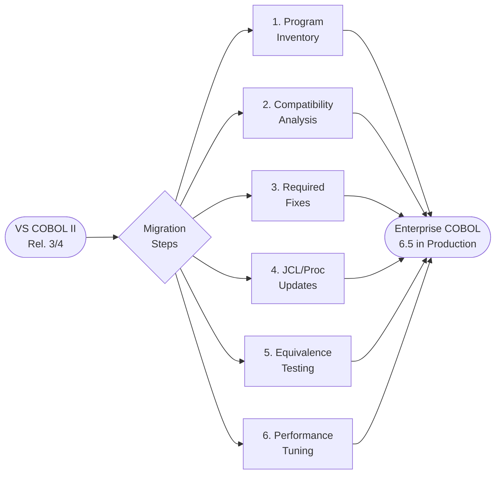

# Modernization Guide: COBOL II → Enterprise COBOL 6.5

> **Specialized skills for this journey:**
> | Skill | Topic |
> |---|---|
> | [`skill-lang-changes.md`](skill-lang-changes.md) | Language and syntax changes |
> | [`skill-compiler-options.md`](skill-compiler-options.md) | Compiler options |
> | [`skill-le-migration.md`](skill-le-migration.md) | Runtime: Language Environment |
> | [`skill-cics-migration.md`](skill-cics-migration.md) | CICS: translator and standards |
> | [`skill-db2-migration.md`](skill-db2-migration.md) | DB2: integrated coprocessor |
> | [`skill-perf-modernization.md`](skill-perf-modernization.md) | Performance and optimization |
> | [`skill-jcl-procedures.md`](skill-jcl-procedures.md) | JCL and compile procedures |

---

## Journey Overview



---

## Step 1 — Program Inventory

Before any code changes, categorize each program according to the
complexity table in the Migration Guide (ref: `skill-migration-v65.md`
Ch.8 "Assigning complexity ratings"):

| Category | Attributes | Impact |
|---|---|---|
| **Simple** | No CICS, no DB2, no CMPR2, no deprecated features | Direct recompile |
| **Medium** | Uses CICS or DB2, uses CMPR2, obsolete JCL options | Targeted adjustments |
| **Complex** | CMPR2 + incompatible features + calls to IGZERRE/IGZETUN | Code refactoring |

**Support tools** (`skill-migration-v65.md` Appendix C):
- `FLAGMIG` — compiler flags constructs incompatible with Enterprise COBOL
- `FLAGMIG4` — flags deprecations specific to 6.x
- COBOL Conversion Aid (CCCA) — automates code conversions
- COBOL Upgrade Advisor for z/OS — analyzes and prioritizes applications

---

## Step 2 — Decision Map by Program Type

```
Does the program use CMPR2?
  YES -> check Table 26 in skill-migration-v65.md for CMPR2/NOCMPR2 differences
         convert to NOCMPR2 before compiling with Enterprise COBOL
  NO  -> proceed to syntax check

Does the program use CICS?
  YES -> check skill-cics-migration.md
         - replace DFHECP1$ with CICS option in the compiler
         - review STOP RUN, CALL, HANDLE CONDITION

Does the program use DB2?
  YES -> check skill-db2-migration.md
         - replace DSNHPC with SQL option in the compiler
         - move DECLARE CURSOR to the DATA DIVISION

Does the program call COBOL II runtime routines (IGZERRE, IGZETUN, IGZCLOC)?
  YES -> check skill-le-migration.md
         - replace with equivalent LE calls (CEE*)

Does the JCL use obsolete compiler options (RES, NORES, SIZE, CMPR2)?
  YES -> check skill-compiler-options.md and skill-jcl-procedures.md
```

---

## Step 3 — Summary of Required Fixes

### 3.1 Language

| # | COBOL II Construct | Action in Enterprise COBOL 6.5 | Skill |
|---|---|---|---|
| L1 | `VALUE` in subordinates of `OCCURS` | Remove; use `INITIALIZE` in the Procedure Division | `skill-lang-changes.md` |
| L2 | `ACCEPT DATE / ACCEPT TIME` | Replace with `FUNCTION CURRENT-DATE` or `EXEC CICS ASKTIME` | `skill-lang-changes.md` |
| L3 | `ALTER` statement | Eliminate — not supported in NOCMPR2 | `skill-lang-changes.md` |
| L4 | `STOP literal` | Replace with `DISPLAY` + `STOP RUN` | `skill-lang-changes.md` |
| L5 | `MOVE CORRESPONDING` with CMPR2 | Check different semantics in NOCMPR2 (Table 26) | `skill-lang-changes.md` |
| L6 | New reserved words (JSON, UTF-8, etc.) | Rename variables that conflict with new reserved words | `skill-lang-changes.md` |

### 3.2 Compiler

| # | COBOL II Option | Action | Skill |
|---|---|---|---|
| C1 | `RES` / `NORES` | Remove — eliminated in EC 5+ | `skill-compiler-options.md` |
| C2 | `RESIDENT` | Remove — eliminated in EC 5+ | `skill-compiler-options.md` |
| C3 | `CMPR2` | Remove and convert program to NOCMPR2 | `skill-compiler-options.md` |
| C4 | `SIZE` | Remove — eliminated in EC 5.2 | `skill-compiler-options.md` |
| C5 | `OPTIMIZE` | Update to `OPT(FULL)` — new standard in 6.x | `skill-compiler-options.md` |
| C6 | `NUMPROC(PFD)` | Replace with `INVDATA` for fine-grained invalid data control | `skill-compiler-options.md` |
| C7 | `TEST` | Use `TEST(DWARF,SEPARATE)` for debug without production overhead | `skill-compiler-options.md` |

### 3.3 Runtime / Language Environment

| # | COBOL II Construct | Action | Skill |
|---|---|---|---|
| R1 | `CALL 'IGZERRE'` | Replace with `CALL 'CEEPIPI'` (LE callable service) | `skill-le-migration.md` |
| R2 | `CALL 'IGZETUN'` | Replace with `CALL 'CEESIGT'` | `skill-le-migration.md` |
| R3 | `CALL 'IGZCLOC'` | Replace with `CALL 'CEEDATM'` | `skill-le-migration.md` |
| R4 | Runtime option `RTEREUS` | Replace with LE `REUSE` | `skill-le-migration.md` |
| R5 | Runtime option `LIBKEEP` | Replace with `CEEBXITA` LE exit | `skill-le-migration.md` |
| R6 | `STAE` / `NOSTAE` | Replace with LE condition handler (`CEEHDLR`) | `skill-le-migration.md` |

### 3.4 CICS

| # | COBOL II Construct | Action | Skill |
|---|---|---|---|
| X1 | `DFHECP1$` step in JCL | Eliminate; add `CICS` option in the compiler | `skill-cics-migration.md` |
| X2 | `STOP RUN` in a CICS program | Replace with `EXEC CICS RETURN END-EXEC` | `skill-cics-migration.md` |
| X3 | `EXEC CICS HANDLE CONDITION` | Replace with `RESP` checking | `skill-cics-migration.md` |
| X4 | `CALL` to CICS subprogram | Pass `DFHEIB` and `DFHCOMMAREA` as the first parameters | `skill-cics-migration.md` |

### 3.5 DB2

| # | COBOL II Construct | Action | Skill |
|---|---|---|---|
| D1 | `DSNHPC` step in JCL | Eliminate; add `SQL` option in the compiler | `skill-db2-migration.md` |
| D2 | `DECLARE CURSOR` in the Procedure Division | Move to the Working-Storage Section | `skill-db2-migration.md` |
| D3 | `EXEC SQL INCLUDE` via `COPY` | Keep as `EXEC SQL INCLUDE` — processed by the coprocessor | `skill-db2-migration.md` |

---

## Step 4 — New Capabilities Recommended for Adoption

Beyond the required fixes, Enterprise COBOL 6.5 offers improvements
worth adopting during migration:

| Capability | Version Introduced | Benefit | Skill |
|---|---|---|---|
| Structured `EVALUATE` | COBOL II (already available) | Eliminates GO TO / nested IF-ELSE | `skill-lang-changes.md` |
| `FUNCTION CURRENT-DATE` | EC 4.x | Standard replacement for ACCEPT DATE/TIME | `skill-lang-changes.md` |
| `JSON GENERATE / JSON PARSE` | EC 6.1 / 6.2 | Native integration with REST APIs | `skill-lang-changes.md` |
| `ALLOCATE / FREE` | EC 6.1 | Dynamic storage management without GETMAIN | `skill-lang-changes.md` |
| `AMODE 64` (`LP(64)`) | EC 6.3 | 64-bit addressing, removes 2GB limit | `skill-compiler-options.md` |
| `ARCH(10)` / `TUNE(10)` | EC 6.3 | Optimization for z15/z16 | `skill-compiler-options.md` |
| `SMARTBIN` | EC 6.4 | Prepares module for IBM ABO without recompilation | `skill-compiler-options.md` |
| `INITCHECK` | EC 6.2 | Detects uninitialized variables at compile time | `skill-compiler-options.md` |
| `NUMCHECK` | EC 6.2 | Detects invalid data in numeric fields | `skill-compiler-options.md` |
| `TEST(DWARF,SEPARATE)` | EC 6.2 | Debug without overhead in the production module | `skill-compiler-options.md` |
| `OPT(FULL)` | EC 5.x | Full optimization replacing OPTIMIZE | `skill-perf-modernization.md` |
| `INVDATA` | EC 6.3 | Replaces NUMPROC/ZONEDATA with fine-grained control | `skill-perf-modernization.md` |

---

## Step 5 — Final Validation Checklist

```
PRE-COMPILATION
[ ] Obsolete options removed from JCL (RES, NORES, RESIDENT, SIZE, CMPR2)
[ ] CICS option added (replaces DFHECP1$)
[ ] SQL option added (replaces DSNHPC)
[ ] SYSLIB includes updated copybooks

LANGUAGE / DATA DIVISION
[ ] VALUE removed from subordinates of OCCURS
[ ] DECLARE CURSOR moved to Working-Storage (DB2 programs)
[ ] Variables conflicting with new reserved words renamed
[ ] COMP documented as BINARY where applicable

LANGUAGE / PROCEDURE DIVISION
[ ] STOP RUN removed from CICS programs
[ ] HANDLE CONDITION replaced with RESP checking
[ ] ACCEPT DATE/TIME replaced with FUNCTION CURRENT-DATE
[ ] IGZERRE/IGZETUN/IGZCLOC calls replaced with LE equivalents

RUNTIME / JCL
[ ] STEPLIB points to CEE.SCEERUN (LE) and not to COBOL II runtime
[ ] REGION=0M and MEMLIMIT>=2G configured for compilation
[ ] DBRMLIB updated for DB2 programs
[ ] DFHRPL configured for CICS programs (CSD updated)

TESTING
[ ] Program compiles with RC=0 or RC=4 (acceptable warnings)
[ ] Functional results identical to the original COBOL II program
[ ] Regression tests executed for all flows
[ ] Dumps/abends analyzed and corrected
```

---

## Cross-References Between Skills

```
skill-guide-modernization.md  (this file — overview)
  ├── skill-lang-changes.md      syntax and semantic changes
  ├── skill-compiler-options.md  compiler options: migration map
  ├── skill-le-migration.md      Language Environment runtime
  ├── skill-cics-migration.md    CICS: integrated translator, RESP, STOP RUN
  ├── skill-db2-migration.md     DB2: coprocessor, DECLARE CURSOR
  ├── skill-perf-modernization.md performance: OPT, ARCH, TUNE, coding
  └── skill-jcl-procedures.md    JCL: procedures and DD statements
```

---

## Sources

All content is derived from official IBM documents available at:

| File | Original Document |
|---|---|
| `skill-migration-v65.md` | Enterprise COBOL for z/OS 6.5 Migration Guide |
| `skill-perf-tuning.md` | VS COBOL II Performance Tuning (Release 3.2/4.0) |
| `skill-le-runtime.md` | z/OS 3.1 Language Environment Programming Guide |
| `skill-cics-standards.md` | Structured CICS COBOL II Programming Standards (ISU-ATS) |
