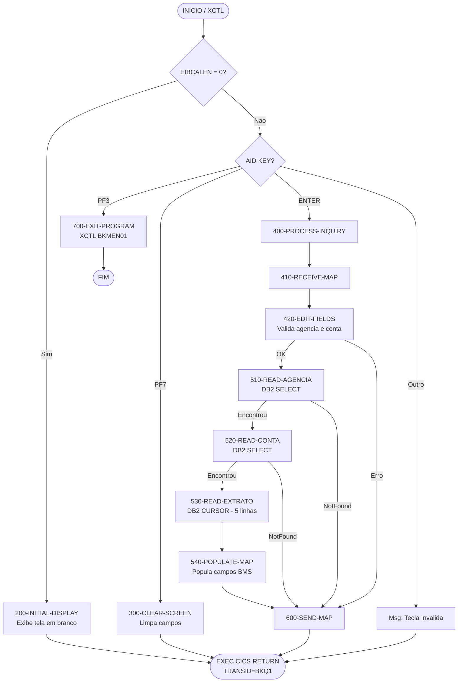

# BKC01 — Consulta de Conta Bancária (CICS COBOL II)

Programa CICS COBOL II para consulta de agência/conta bancária com
exibição de saldo e extrato dos últimos 5 dias, acessando tabelas DB2.

---

## Estrutura de Arquivos

```
CICS-BKC01/
├── src/
│   └── BKC01.cbl           # Programa principal CICS COBOL II
├── maps/
│   └── BKCONS0.txt         # BMS Mapset (assembly source)
├── copybooks/
│   ├── BKAGCD.cpy          # DCLGEN - BANCO.AGENCIA
│   ├── BKCTCD.cpy          # DCLGEN - BANCO.CONTA
│   └── BKEXCD.cpy          # DCLGEN - BANCO.EXTRATO_MOV
└── jcl/
    └── BKJCL01J.jcl        # JCL de compilação (6 steps)
```

---

## Layout da Tela (3270 - 24x80)

```
+--------------------------------------------------------------------------------+
| BKQ1  ** CONSULTA DE CONTA BANCARIA **             DATA.: DD/MM/AAAA          |
|                                                                                |
| AGENCIA..: ____                                                                |
| CONTA....: __________                                                          |
|                                                                                |
| NOME CLIENTE.: <NOME DO CLIENTE - 40 CHARS>                                   |
| TIPO CONTA...: <DESCRICAO TIPO CONTA>                                          |
| SALDO ATUAL..: ZZZ.ZZZ.ZZ9,99-                                                |
|                                                                                |
| -- EXTRATO ULTIMOS 5 DIAS ------------------------------------------          |
| DATA       HISTORICO             TIPO   VALOR          SALDO                  |
| DD/MM/AAAA <HISTORICO 20 CHARS>  <TIPO> ZZZ.ZZ9,99-   ZZZ.ZZ9,99-            |
| DD/MM/AAAA <HISTORICO 20 CHARS>  <TIPO> ZZZ.ZZ9,99-   ZZZ.ZZ9,99-            |
| DD/MM/AAAA <HISTORICO 20 CHARS>  <TIPO> ZZZ.ZZ9,99-   ZZZ.ZZ9,99-            |
| DD/MM/AAAA <HISTORICO 20 CHARS>  <TIPO> ZZZ.ZZ9,99-   ZZZ.ZZ9,99-            |
| DD/MM/AAAA <HISTORICO 20 CHARS>  <TIPO> ZZZ.ZZ9,99-   ZZZ.ZZ9,99-            |
|                                                                                |
|                                                                                |
|                                                                                |
|                                                                                |
| PF3=SAIR  PF7=LIMPAR  ENTER=CONSULTAR                                         |
| BKC01  <MENSAGEM ERRO - 36 CHARS>         <MENSAGEM NORMAL - 36 CHARS>        |
+--------------------------------------------------------------------------------+
```

---

## Fluxo do Programa



---

## Tabelas DB2

### BANCO.AGENCIA
| Coluna           | Tipo         | Descrição              |
|------------------|--------------|------------------------|
| AG_COD_AGENCIA   | CHAR(4)      | Código da agência (PK) |
| AG_NOM_AGENCIA   | VARCHAR(40)  | Nome da agência        |
| AG_NOM_CIDADE    | VARCHAR(30)  | Cidade                 |
| AG_NOM_ESTADO    | CHAR(2)      | Estado (UF)            |
| AG_NUM_TELEFONE  | CHAR(14)     | Telefone               |
| AG_DAT_ABERTURA  | DATE         | Data de abertura       |

### BANCO.CONTA
| Coluna           | Tipo          | Descrição               |
|------------------|---------------|-------------------------|
| CT_COD_AGENCIA   | CHAR(4)       | Agência (FK)            |
| CT_NUM_CONTA     | CHAR(10)      | Número da conta (PK)    |
| CT_NOM_CLIENTE   | VARCHAR(40)   | Nome do cliente         |
| CT_COD_TIPO_CONTA| CHAR(2)       | Código tipo (CC/PP/...)  |
| CT_DES_TIPO_CONTA| VARCHAR(20)   | Descrição tipo conta    |
| CT_VLR_SALDO     | DECIMAL(15,2) | Saldo atual             |
| CT_DAT_ABERTURA  | DATE          | Data de abertura        |
| CT_COD_STATUS    | CHAR(1)       | Status: A=Ativa, I=Inativa |

### BANCO.EXTRATO_MOV
| Coluna              | Tipo           | Descrição              |
|---------------------|----------------|------------------------|
| EX_COD_AGENCIA      | CHAR(4)        | Agência (FK)           |
| EX_NUM_CONTA        | CHAR(10)       | Conta (FK)             |
| EX_DAT_MOVIMENTO    | DATE           | Data do movimento      |
| EX_NUM_SEQ          | SMALLINT       | Seq. do movimento      |
| EX_COD_TIPO_MOV     | CHAR(3)        | DEB/CRD/TRF/...        |
| EX_DES_HISTORICO    | VARCHAR(20)    | Histórico              |
| EX_VLR_MOVIMENTO    | DECIMAL(13,2)  | Valor do movimento     |
| EX_VLR_SALDO_APOS   | DECIMAL(15,2)  | Saldo após movimento   |

---

## PF Keys (SAA Standard)

| Tecla  | Ação                              |
|--------|-----------------------------------|
| ENTER  | Executar consulta                 |
| PF3    | Sair / Retornar ao menu (BKMEN01) |
| PF7    | Limpar campos da tela             |

---

## Passos de Compilação (JCL BKJCL01J)

| Step      | Programa  | Descrição                              |
|-----------|-----------|----------------------------------------|
| ASMMAP    | ASMA90    | Assembla o BMS Mapset BKCONS0          |
| LNKMAP    | IEWL      | Linka o mapset no CICS.LOAD            |
| DB2PREC   | DSNHPC    | Pré-compila SQL e gera DBRM            |
| CICSTRAN  | DFHECP1$  | Traduz comandos EXEC CICS (Translator) |
| COBCOMP   | IGYCRCTL  | Compila COBOL II (RENT,RES,OPT)        |
| LNKPGM    | IEWL      | Linka módulo no BANCO.CICS.LOAD        |

---

## Estrutura Modular (Padrão ISU-ATS)

```
000-MAINLINE
├── 100-INITIALIZE
│   └── 910-GET-CURRENT-DATE      (I/O)
├── 200-INITIAL-DISPLAY           (1a execucao)
├── 300-CLEAR-SCREEN              (PF7)
├── 400-PROCESS-INQUIRY           (ENTER)
│   ├── 410-RECEIVE-MAP           (I/O)
│   ├── 420-EDIT-FIELDS
│   └── 500-DB2-QUERY
│       ├── 510-READ-AGENCIA      (I/O DB2)
│       ├── 520-READ-CONTA        (I/O DB2)
│       ├── 530-READ-EXTRATO      (I/O DB2 cursor)
│       └── 540-POPULATE-MAP
├── 600-SEND-MAP                  (I/O)
├── 700-EXIT-PROGRAM              (PF3)
├── 880-DB2-ERROR                 (I/O - erro)
└── 890-CICS-ERROR                (I/O - abend)
```

---

## Observações Importantes

1. **ENVIRONMENT DIVISION** — omitida propositalmente; em CICS COBOL II
   os arquivos são gerenciados pela FCT (File Control Table).
2. **STOP RUN** — presente apenas como sentinela após o EXEC CICS RETURN;
   o controle nunca chega até ele.
3. **SQL CURSOR** — o cursor `CSREXTRATO` usa `FETCH FIRST 5 ROWS ONLY`
   e filtro `>= CURRENT DATE - 5 DAYS` para limitar o extrato.
4. **COMP-3** — todos os campos numéricos quantitativos usam COMP-3
   conforme padrão ISU-ATS (seção "Numeric Fields").
5. **RESP vs HANDLE** — tratamento de erros via RESP em todos os comandos
   CICS, conforme padrão da seção "Error Handling" do documento de standards.

---

## Referência

Programa gerado conforme:
- `Docs-Convertidos/Structured-CICS-COBOLII-Programming-Standards.md`
  — seções: Identification Division, Working-Storage, Linkage Section,
  Procedure Division, Modularized Procedure Division, Error Handling,
  Recommended EXEC CICS Commands, Standard Screen Formats, PF Key Designations.
