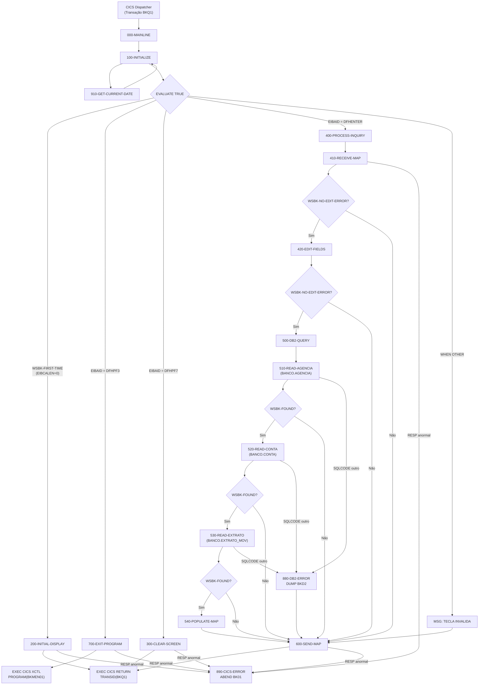

# BKC01 — Documentação Técnica Detalhada

> **Sistema:** Sistema Bancário (BKSI)  
> **Transação CICS:** BKQ1  
> **Mapset / Map:** BKCONS0 / BKCON01  
> **Compilador original:** VS COBOL II (IGYCRCTL v2.4)  
> **Data de criação:** 2024-01-01  
> **Autor:** DEMO COBOL II CICS  

---

## Sumário

1. [Visão Geral do Programa](#1-visão-geral-do-programa)
2. [Arquitetura e Componentes](#2-arquitetura-e-componentes)
3. [Estrutura de Dados](#3-estrutura-de-dados)
   - 3.1 [Working-Storage Section](#31-working-storage-section)
   - 3.2 [Linkage Section](#32-linkage-section)
   - 3.3 [Copybooks e DCLGENs](#33-copybooks-e-dclgens)
4. [Mapa BMS — BKCON01](#4-mapa-bms--bkcon01)
5. [Lógica de Processamento — Procedure Division](#5-lógica-de-processamento--procedure-division)
   - 5.1 [Fluxo Principal — 000-MAINLINE](#51-fluxo-principal--000-mainline)
   - 5.2 [100-INITIALIZE](#52-100-initialize)
   - 5.3 [200-INITIAL-DISPLAY](#53-200-initial-display)
   - 5.4 [300-CLEAR-SCREEN](#54-300-clear-screen)
   - 5.5 [400-PROCESS-INQUIRY](#55-400-process-inquiry)
   - 5.6 [410-RECEIVE-MAP](#56-410-receive-map)
   - 5.7 [420-EDIT-FIELDS](#57-420-edit-fields)
   - 5.8 [500-DB2-QUERY](#58-500-db2-query)
   - 5.9 [510-READ-AGENCIA](#59-510-read-agencia)
   - 5.10 [520-READ-CONTA](#510-520-read-conta)
   - 5.11 [530-READ-EXTRATO](#511-530-read-extrato)
   - 5.12 [540-POPULATE-MAP](#512-540-populate-map)
   - 5.13 [600-SEND-MAP](#513-600-send-map)
   - 5.14 [700-EXIT-PROGRAM](#514-700-exit-program)
   - 5.15 [880-DB2-ERROR](#515-880-db2-error)
   - 5.16 [890-CICS-ERROR](#516-890-cics-error)
   - 5.17 [910-GET-CURRENT-DATE](#517-910-get-current-date)
6. [Diagrama de Fluxo de Controle](#6-diagrama-de-fluxo-de-controle)
7. [Tabelas DB2 Acessadas](#7-tabelas-db2-acessadas)
8. [Comandos CICS Utilizados](#8-comandos-cics-utilizados)
9. [Regras de Negócio](#9-regras-de-negócio)
10. [Tratamento de Erros](#10-tratamento-de-erros)
11. [JCL de Compilação — BKJCL01J](#11-jcl-de-compilação--bkjcl01j)
12. [Dependências e Artefatos](#12-dependências-e-artefatos)

---

## 1. Visão Geral do Programa

`BKC01` é um programa CICS **pseudo-conversacional** de consulta bancária.
Dada uma agência (4 dígitos) e um número de conta (10 caracteres), o programa:

1. Valida os campos de entrada.
2. Consulta o cadastro da agência em `BANCO.AGENCIA`.
3. Consulta o cadastro da conta em `BANCO.CONTA`.
4. Lê os últimos 5 movimentos financeiros de `BANCO.EXTRATO_MOV` via cursor DB2.
5. Exibe os dados no mapa BMS `BKCON01` no terminal 3270.

O programa opera exclusivamente por teclado — sem leitura de arquivos VSAM
(a FCT do CICS gerencia arquivos; a `FILE SECTION` está vazia intencionalmente).

| Atributo | Valor |
|---|---|
| Program-ID | `BKC01` |
| Transação | `BKQ1` |
| Mapset | `BKCONS0` |
| Map | `BKCON01` |
| COMMAREA | 900 bytes |
| Tipo | Pseudo-conversacional |
| Linguagem | VS COBOL II / CICS + DB2 |

---

## 2. Arquitetura e Componentes

```
┌─────────────────────────────────────────────────────────┐
│                  Terminal 3270                           │
│          Mapa BKCON01 (BKCONS0)                         │
└───────────────────┬─────────────────────────────────────┘
                    │ EXEC CICS SEND / RECEIVE
┌───────────────────▼─────────────────────────────────────┐
│              BKC01 (Programa CICS)                       │
│                                                         │
│  000-MAINLINE                                           │
│   ├── 100-INITIALIZE                                    │
│   │    └── 910-GET-CURRENT-DATE                         │
│   ├── 200-INITIAL-DISPLAY   (primeiro acesso)           │
│   ├── 300-CLEAR-SCREEN      (PF7)                       │
│   ├── 400-PROCESS-INQUIRY   (ENTER)                     │
│   │    ├── 410-RECEIVE-MAP                              │
│   │    ├── 420-EDIT-FIELDS                              │
│   │    ├── 500-DB2-QUERY                                │
│   │    │    ├── 510-READ-AGENCIA  ──► BANCO.AGENCIA     │
│   │    │    ├── 520-READ-CONTA    ──► BANCO.CONTA        │
│   │    │    ├── 530-READ-EXTRATO  ──► BANCO.EXTRATO_MOV  │
│   │    │    └── 540-POPULATE-MAP                        │
│   │    └── 600-SEND-MAP                                 │
│   └── 700-EXIT-PROGRAM      (PF3) ──► XCTL BKMEN01     │
│                                                         │
│   Erros: 880-DB2-ERROR / 890-CICS-ERROR                │
└─────────────────────────────────────────────────────────┘
         │
         │ DB2 SQL (3 tabelas)
┌────────▼────────────────────────────────────────────────┐
│  BANCO.AGENCIA      BANCO.CONTA      BANCO.EXTRATO_MOV  │
└─────────────────────────────────────────────────────────┘
```

---

## 3. Estrutura de Dados

### 3.1 Working-Storage Section

| Grupo / Campo | PIC | Uso | Descrição |
|---|---|---|---|
| `WSBK-BEGINS` | `X(16)` | VALUE `'BKC01 WS BEGINS'` | Literal de início para facilitar DUMP/debug |
| `WSBK-CONSTANTS` | Grupo | — | Constantes do programa |
| `  WSBK-PROGRAM-ID` | `X(8)` | `'BKC01   '` | ID do programa |
| `  WSBK-MAPSET` | `X(8)` | `'BKCONS0 '` | Nome do mapset BMS |
| `  WSBK-MAP01` | `X(8)` | `'BKCON01 '` | Nome do mapa BMS |
| `  WSBK-TRANSID` | `X(4)` | `'BKQ1'` | Transaction ID para RETURN |
| `  WSBK-MENU-PROGRAM` | `X(8)` | `'BKMEN01 '` | Programa de menu para XCTL |
| `WSBK-KEYS` | Grupo | — | Chaves de pesquisa |
| `  WSBK-COD-AGENCIA` | `X(4)` | — | Código da agência recebido do mapa |
| `  WSBK-NUM-CONTA` | `X(10)` | — | Número da conta recebido do mapa |
| `WSBK-SWITCHES` | Grupo | — | Flags de controle de fluxo |
| `  WSBK-FIRST-TIME-SW` | `X(1)` | 88: `Y`/`N` | Indica primeiro acesso (EIBCALEN=0) |
| `  WSBK-EDIT-ERROR-SW` | `X(1)` | 88: `Y`/`N` | Sinaliza erro de edição nos campos |
| `  WSBK-FOUND-SW` | `X(1)` | 88: `Y`/`N` | Sinaliza se registro DB2 foi encontrado |
| `WSBK-CURSOR-ON` | `S9(4) COMP` | VALUE -1 | Posiciona cursor no campo (-1 = BMS posiciona) |
| `WSBK-EXTRATO-CTR` | `S9(4) COMP` | VALUE ZERO | Contador de linhas de extrato lidas (0–5) |
| `WSBK-DATE-AREA` | Grupo | — | Área de data atual |
| `  WSBK-ABSTIME` | `S9(15) COMP-3` | — | Tempo absoluto CICS (ASKTIME) |
| `  WSBK-DATE-DISPLAY` | `X(10)` | — | Data formatada DD/MM/YYYY |
| `WSBK-MESSAGES` | Grupo | — | Área de mensagens para o mapa |
| `  WSBK-MSG-NORMAL` | `X(36)` | — | Mensagem de sucesso (M01MSGR) |
| `  WSBK-MSG-ERROR` | `X(36)` | — | Mensagem de erro (M01MSGL) |
| `WSBK-CICS-RESP` | `S9(8) COMP` | — | Código de retorno CICS (RESP=) |
| `  WSBK-CICS-NORMAL` | 88 | VALUE 0 | RESP = DFHRESP(NORMAL) |
| `  WSBK-CICS-NOTFND` | 88 | VALUE 13 | RESP = DFHRESP(NOTFND) |
| `  WSBK-CICS-ENDFILE` | 88 | VALUE 11 | RESP = DFHRESP(ENDFILE) |
| `WSBK-ABEND-CODE` | `X(4)` | VALUE `'BK01'` | Código de abend para EXEC CICS ABEND |
| `WSBK-EXTRATO-LINES` | Grupo | — | Tabela interna de extrato (5 entradas) |
| `  WSBK-EXT-ENTRY` | OCCURS 5 INDEXED BY `WSBK-EXT-IDX` | — | Linha de extrato |
| `    WSBK-EXT-DATA` | `X(10)` | — | Data do movimento (DD/MM/YYYY) |
| `    WSBK-EXT-HIST` | `X(20)` | — | Texto do histórico |
| `    WSBK-EXT-TIPO` | `X(6)` | — | Tipo de movimento (DEB/CRE) |
| `    WSBK-EXT-VALOR` | `S9(11)V99 COMP-3` | — | Valor do movimento |
| `    WSBK-EXT-SALDO` | `S9(13)V99 COMP-3` | — | Saldo após o movimento |

**SQL INCLUDEs na Working-Storage:**

| INCLUDE | Origem | Conteúdo |
|---|---|---|
| `BKAGCD` | [`CICS-BKC01/copybooks/BKAGCD.cpy`](../copybooks/BKAGCD.cpy) | DCLGEN `DCLAGENCIA` — tabela `BANCO.AGENCIA` |
| `BKCTCD` | [`CICS-BKC01/copybooks/BKCTCD.cpy`](../copybooks/BKCTCD.cpy) | DCLGEN `DCLCONTA` — tabela `BANCO.CONTA` |
| `BKEXCD` | [`CICS-BKC01/copybooks/BKEXCD.cpy`](../copybooks/BKEXCD.cpy) | DCLGEN `DCLEXTRATO` — tabela `BANCO.EXTRATO_MOV` |
| `SQLCA` | Sistema DB2 | SQL Communication Area (SQLCODE, SQLERRM, etc.) |

**COPYs BMS na Working-Storage:**

| COPY | Conteúdo |
|---|---|
| `BKCON01` | DSECT simbólico do mapa — campos `BKCON01I` (input) e `BKCON01O` (output) |
| `DFHBMSCA` | Atributos BMS padrão (`DFHBMASF`, `DFHBMFSB`, etc.) |
| `DFHAID` | Identificadores de AID (`DFHENTER`, `DFHPF3`, `DFHPF7`, etc.) |

---

### 3.2 Linkage Section

| Campo | PIC | Descrição |
|---|---|---|
| `DFHCOMMAREA` | `X(900)` | Communication area de 900 bytes — passada em `EXEC CICS RETURN` para preservar estado entre transações. Utilizada para distinguir o primeiro acesso (`EIBCALEN = 0`) de re-entradas. |

---

### 3.3 Copybooks e DCLGENs

#### BKAGCD — Tabela `BANCO.AGENCIA`

| Campo COBOL | Coluna DB2 | Tipo SQL | Descrição |
|---|---|---|---|
| `AG-COD-AGENCIA` | `AG_COD_AGENCIA` | `CHAR(4) NOT NULL` | Código da agência (chave) |
| `AG-NOM-AGENCIA` | `AG_NOM_AGENCIA` | `VARCHAR(40) NOT NULL` | Nome da agência |
| `AG-NOM-CIDADE` | `AG_NOM_CIDADE` | `VARCHAR(30) NOT NULL` | Cidade da agência |
| `AG-NOM-ESTADO` | `AG_NOM_ESTADO` | `CHAR(2) NOT NULL` | UF da agência |
| `AG-NUM-TELEFONE` | `AG_NUM_TELEFONE` | `CHAR(14)` | Telefone (nullable) |
| `AG-DAT-ABERTURA` | `AG_DAT_ABERTURA` | `DATE NOT NULL` | Data de abertura |

> `AG-NOM-AGENCIA` e `AG-NOM-CIDADE` são VARCHAR: estrutura de dois subcampos
> (`AG-NOM-AGENCIA-LEN PIC S9(4) COMP` + `AG-NOM-AGENCIA-TEXT PIC X(40)`).

#### BKCTCD — Tabela `BANCO.CONTA`

| Campo COBOL | Coluna DB2 | Tipo SQL | Descrição |
|---|---|---|---|
| `CT-COD-AGENCIA` | `CT_COD_AGENCIA` | `CHAR(4) NOT NULL` | Código da agência (FK) |
| `CT-NUM-CONTA` | `CT_NUM_CONTA` | `CHAR(10) NOT NULL` | Número da conta |
| `CT-NOM-CLIENTE` | `CT_NOM_CLIENTE` | `VARCHAR(40) NOT NULL` | Nome do cliente |
| `CT-COD-TIPO-CONTA` | `CT_COD_TIPO_CONTA` | `CHAR(2) NOT NULL` | Código do tipo de conta |
| `CT-DES-TIPO-CONTA` | `CT_DES_TIPO_CONTA` | `VARCHAR(20) NOT NULL` | Descrição do tipo de conta |
| `CT-VLR-SALDO` | `CT_VLR_SALDO` | `DECIMAL(15,2) NOT NULL` | Saldo atual |
| `CT-DAT-ABERTURA` | `CT_DAT_ABERTURA` | `DATE NOT NULL` | Data de abertura |
| `CT-COD-STATUS` | `CT_COD_STATUS` | `CHAR(1) NOT NULL` | Status da conta |

#### BKEXCD — Tabela `BANCO.EXTRATO_MOV`

| Campo COBOL | Coluna DB2 | Tipo SQL | Descrição |
|---|---|---|---|
| `EX-COD-AGENCIA` | `EX_COD_AGENCIA` | `CHAR(4) NOT NULL` | Código da agência |
| `EX-NUM-CONTA` | `EX_NUM_CONTA` | `CHAR(10) NOT NULL` | Número da conta |
| `EX-DAT-MOVIMENTO` | `EX_DAT_MOVIMENTO` | `DATE NOT NULL` | Data do movimento |
| `EX-NUM-SEQ` | `EX_NUM_SEQ` | `SMALLINT NOT NULL` | Sequência do movimento no dia |
| `EX-COD-TIPO-MOV` | `EX_COD_TIPO_MOV` | `CHAR(3) NOT NULL` | Tipo (DEB / CRE / ...) |
| `EX-DES-HISTORICO` | `EX_DES_HISTORICO` | `VARCHAR(20) NOT NULL` | Histórico |
| `EX-VLR-MOVIMENTO` | `EX_VLR_MOVIMENTO` | `DECIMAL(13,2) NOT NULL` | Valor do movimento |
| `EX-VLR-SALDO-APOS` | `EX_VLR_SALDO_APOS` | `DECIMAL(15,2) NOT NULL` | Saldo após o movimento |

---

## 4. Mapa BMS — BKCON01

**Mapset:** `BKCONS0` | **Arquivo:** [`CICS-BKC01/maps/BKCONS0.bms`](../maps/BKCONS0.bms)  
**Terminais:** `3270-2` | **Tamanho:** 24 linhas × 80 colunas | **Modo:** `INOUT`

### Layout da Tela

```
Col: 1234567890123456789012345678901234567890123456789012345678901234567890123456789 0
     ┌──────────────────────────────────────────────────────────────────────────────┐
L01  │   ** CONSULTA DE CONTA BANCARIA **                   DATA.: DD/MM/YYYY      │
L02  │                                                                              │
L03  │ AGENCIA..: [XXXX]                                                            │
L04  │ CONTA....: [XXXXXXXXXX]                                                      │
L05  │                                                                              │
L06  │ NOME CLIENTE.: XXXXXXXXXXXXXXXXXXXXXXXXXXXXXXXXXXXXXXXX                      │
L07  │ TIPO CONTA...: XXXXXXXXXXXXXXXXXXXX                                          │
L08  │ SALDO ATUAL..: ZZZ.ZZZ.ZZ9,99-                                              │
L09  │                                                                              │
L10  │ -- EXTRATO ULTIMOS 5 DIAS -----------------------------------------------   │
L11  │ DATA       HISTORICO             TIPO  VALOR            SALDO               │
L12  │ DD/MM/YYYY XXXXXXXXXXXXXXXXXXXX  XXX   ZZZ.ZZ9,99-      ZZZ.ZZ9,99-         │
L13  │ DD/MM/YYYY XXXXXXXXXXXXXXXXXXXX  XXX   ZZZ.ZZ9,99-      ZZZ.ZZ9,99-         │
L14  │ DD/MM/YYYY XXXXXXXXXXXXXXXXXXXX  XXX   ZZZ.ZZ9,99-      ZZZ.ZZ9,99-         │
L15  │ DD/MM/YYYY XXXXXXXXXXXXXXXXXXXX  XXX   ZZZ.ZZ9,99-      ZZZ.ZZ9,99-         │
L16  │ DD/MM/YYYY XXXXXXXXXXXXXXXXXXXX  XXX   ZZZ.ZZ9,99-      ZZZ.ZZ9,99-         │
...
L22  │ PF3=SAIR  PF7=LIMPAR  ENTER=CONSULTAR                                       │
L23  │ BKC01 [MSGL - 36 chars de erro    ] [MSGR - 36 chars normais ]              │
     └──────────────────────────────────────────────────────────────────────────────┘
```

### Campos do Mapa

| Campo BMS | Linha | Col | Tam | Atributo | Tipo | Descrição |
|---|---|---|---|---|---|---|
| `M01FUNC` | 1 | 1 | 2 | UNPROT,FSET | I/O | Campo de função (reservado) |
| `M01DATE` | 1 | 62 | 10 | ASKIP,FSET | Output | Data atual DD/MM/YYYY |
| `M01AGEN` | 3 | 13 | 4 | UNPROT,FSET | Input | Código da agência |
| `M01CONT` | 4 | 13 | 10 | UNPROT,FSET | Input | Número da conta |
| `M01NOME` | 6 | 17 | 40 | ASKIP,FSET | Output | Nome do cliente |
| `M01TIPO` | 7 | 17 | 20 | ASKIP,FSET | Output | Tipo de conta |
| `M01SALD` | 8 | 17 | 18 | ASKIP,FSET | Output | Saldo (PICOUT `ZZZ.ZZZ.ZZ9,99-`) |
| `M01DT1`–`M01DT5` | 12–16 | 1 | 10 | ASKIP,FSET | Output | Data do movimento (linha 1–5) |
| `M01HI1`–`M01HI5` | 12–16 | 12 | 20 | ASKIP,FSET | Output | Histórico do movimento (linha 1–5) |
| `M01TP1`–`M01TP5` | 12–16 | 33 | 6 | ASKIP,FSET | Output | Tipo do movimento (linha 1–5) |
| `M01VL1`–`M01VL5` | 12–16 | 40 | 14 | ASKIP,FSET | Output | Valor do movimento (linha 1–5) |
| `M01SL1`–`M01SL5` | 12–16 | 55 | 14 | ASKIP,FSET | Output | Saldo após movimento (linha 1–5) |
| `M01PROG` | 23 | 1 | 5 | ASKIP,BRT | Output | ID do programa (`BKC01`) |
| `M01MSGL` | 23 | 7 | 36 | ASKIP,BRT | Output | Mensagem de erro |
| `M01MSGR` | 23 | 44 | 36 | ASKIP | Output | Mensagem normal |

> Os campos de input (`M01AGEN`, `M01CONT`) geram os subcampos simbólicos
> `M01AGENx`, `M01CONTx` onde `x` = `I` (input), `O` (output), `L` (length),
> `A` (attribute), `F` (flag). Ex: `M01AGENI`, `M01AGENA`, `M01AGENL`.

---

## 5. Lógica de Processamento — Procedure Division

### 5.1 Fluxo Principal — 000-MAINLINE

**Arquivo:** [`BKC01.cbl`](../src/BKC01.cbl) — linha 172

Ponto de entrada único do programa CICS. Executa sempre que a transação `BKQ1` é disparada (re-entry pelo `EXEC CICS RETURN TRANSID`).

```
000-MAINLINE
 ├─ PERFORM 100-INITIALIZE
 └─ EVALUATE TRUE
     ├─ WHEN WSBK-FIRST-TIME      → PERFORM 200-INITIAL-DISPLAY
     ├─ WHEN EIBAID = DFHPF3      → PERFORM 700-EXIT-PROGRAM
     ├─ WHEN EIBAID = DFHPF7      → PERFORM 300-CLEAR-SCREEN
     ├─ WHEN EIBAID = DFHENTER    → PERFORM 400-PROCESS-INQUIRY
     └─ WHEN OTHER                → Mensagem de tecla inválida + PERFORM 600-SEND-MAP
 └─ EXEC CICS RETURN TRANSID(BKQ1) COMMAREA(DFHCOMMAREA) LENGTH(900)
```

> **Padrão pseudo-conversacional:** O programa retorna imediatamente ao CICS
> após o `EXEC CICS RETURN`, re-associando a transação `BKQ1` para que o próximo
> pressionamento de tecla do operador ative uma nova instância do programa.

---

### 5.2 100-INITIALIZE

**Linha:** 220

Inicializa o estado do programa em cada re-entrada.

| Ação | Condição |
|---|---|
| `SET WSBK-FIRST-TIME TO TRUE` | Se `EIBCALEN = ZERO` (primeiro acesso — sem COMMAREA) |
| `SET WSBK-NOT-FIRST-TIME TO TRUE` | Se `EIBCALEN > 0` (re-entrada com COMMAREA) |
| Limpa flags de erro e found | Sempre |
| Limpa mensagens | Sempre |
| `PERFORM 910-GET-CURRENT-DATE` | Sempre — obtém data atual via CICS |

> `EIBCALEN` contém o tamanho da COMMAREA recebida. Zero indica a primeira
> invocação da transação na sessão.

---

### 5.3 200-INITIAL-DISPLAY

**Linha:** 243

Exibe a tela em branco na primeira entrada do operador.

- Limpa o mapa de input `BKCON01I`.
- Posiciona a data no campo `M01DATEO`.
- Define a mensagem inicial: `'INFORME AGENCIA E CONTA'`.
- Posiciona o cursor no campo `M01AGEN` (`WSBK-CURSOR-ON = -1`).
- Emite `EXEC CICS SEND MAP ... ERASE FREEKB CURSOR`.
- Verifica `WSBK-CICS-RESP`; se anormal, chama `890-CICS-ERROR`.

---

### 5.4 300-CLEAR-SCREEN

**Linha:** 273 | Ativado por: **PF7**

Limpa os campos de entrada e saída do mapa e re-exibe a tela vazia.

- Limpa `BKCON01I` e `BKCON01O`.
- Exibe mensagem `'TELA LIMPA - INFORME OS DADOS'`.
- Comportamento de SEND idêntico a `200-INITIAL-DISPLAY`.

---

### 5.5 400-PROCESS-INQUIRY

**Linha:** 304 | Ativado por: **ENTER**

Coordenador da consulta. Executa os passos em cascata com guarda de erro entre cada um:

```
400-PROCESS-INQUIRY
 ├─ PERFORM 410-RECEIVE-MAP          ← lê dados do terminal
 ├─ IF WSBK-NO-EDIT-ERROR
 │    PERFORM 420-EDIT-FIELDS        ← valida campos
 ├─ IF WSBK-NO-EDIT-ERROR
 │    PERFORM 500-DB2-QUERY          ← consulta DB2
 └─ PERFORM 600-SEND-MAP             ← envia tela (com dados ou erros)
```

---

### 5.6 410-RECEIVE-MAP

**Linha:** 328

Recebe os dados digitados pelo operador.

- `EXEC CICS RECEIVE MAP(BKCON01) INTO(BKCON01I) RESP(WSBK-CICS-RESP)`
- Copia `M01AGENI` → `WSBK-COD-AGENCIA` e `M01CONTI` → `WSBK-NUM-CONTA`.
- Erro no RECEIVE → `890-CICS-ERROR` (abend `BK01`).

---

### 5.7 420-EDIT-FIELDS

**Linha:** 351

Validação dos campos de entrada. Para cada campo, verifica:
1. **Tamanho zero** (`M01xL = +0`): campo não foi digitado.
2. **Conteúdo branco** (`M01xI = SPACES`): campo digitado com espaços.

| Campo | Erro detectado | Ação |
|---|---|---|
| `M01AGEN` (agência) | Comprimento zero **ou** espaços | Posiciona cursor, acende `DFHBMFSB` (brilho), seta `WSBK-EDIT-ERROR-SW = 'Y'` |
| `M01CONT` (conta) | Comprimento zero **ou** espaços | Idem; só posiciona cursor se `WSBK-NO-EDIT-ERROR` (primeiro erro) |

Ao final, se `WSBK-EDIT-ERROR`, define `WSBK-MSG-ERROR = 'EDIT ERROR DETECTED'`.

> **Nota de migração:** As linhas que executam `MOVE 'Y' TO WSBK-EDIT-ERROR-SW`
> deveriam usar `SET WSBK-EDIT-ERROR TO TRUE` — padrão recomendado em
> Enterprise COBOL 6.5 (`skill-cics-standards.md` §"Checking Conditions").

---

### 5.8 500-DB2-QUERY

**Linha:** 398

Orquestra as três consultas DB2 em sequência curto-circuitada por `WSBK-FOUND`:

```
500-DB2-QUERY
 ├─ PERFORM 510-READ-AGENCIA
 ├─ IF WSBK-FOUND → PERFORM 520-READ-CONTA
 ├─ IF WSBK-FOUND → PERFORM 530-READ-EXTRATO
 └─ IF WSBK-FOUND → PERFORM 540-POPULATE-MAP
                    MOVE 'CONSULTA REALIZADA COM SUCESSO' TO WSBK-MSG-NORMAL
```

---

### 5.9 510-READ-AGENCIA

**Linha:** 425 | Tabela: `BANCO.AGENCIA`

```sql
SELECT AG_COD_AGENCIA, AG_NOM_AGENCIA, AG_NOM_CIDADE, AG_NOM_ESTADO
INTO   :AG-COD-AGENCIA, :AG-NOM-AGENCIA, :AG-NOM-CIDADE, :AG-NOM-ESTADO
FROM   BANCO.AGENCIA
WHERE  AG_COD_AGENCIA = :AG-COD-AGENCIA
```

| SQLCODE | Ação |
|---|---|
| `0` | `SET WSBK-FOUND TO TRUE` |
| `100` (NOT FOUND) | `SET WSBK-NOT-FOUND`, mensagem `'AGENCIA NAO ENCONTRADA'`, atributo de erro no campo `M01AGEN` |
| Outro | `PERFORM 880-DB2-ERROR` |

---

### 5.10 520-READ-CONTA

**Linha:** 462 | Tabela: `BANCO.CONTA`

```sql
SELECT CT_COD_AGENCIA, CT_NUM_CONTA, CT_NOM_CLIENTE,
       CT_COD_TIPO_CONTA, CT_DES_TIPO_CONTA, CT_VLR_SALDO, CT_COD_STATUS
INTO   :CT-COD-AGENCIA, :CT-NUM-CONTA, :CT-NOM-CLIENTE,
       :CT-COD-TIPO-CONTA, :CT-DES-TIPO-CONTA, :CT-VLR-SALDO, :CT-COD-STATUS
FROM   BANCO.CONTA
WHERE  CT_COD_AGENCIA = :CT-COD-AGENCIA
AND    CT_NUM_CONTA   = :CT-NUM-CONTA
```

| SQLCODE | Ação |
|---|---|
| `0` | `SET WSBK-FOUND TO TRUE` |
| `100` | `SET WSBK-NOT-FOUND`, mensagem `'CONTA NAO ENCONTRADA'`, atributo de erro em `M01CONT` |
| Outro | `PERFORM 880-DB2-ERROR` |

---

### 5.11 530-READ-EXTRATO

**Linha:** 506 | Tabela: `BANCO.EXTRATO_MOV` | Cursor: `CSREXTRATO`

Inicializa o buffer de 5 entradas com espaços/zeros, depois processa o cursor:

```sql
DECLARE CSREXTRATO CURSOR FOR
SELECT EX_DAT_MOVIMENTO, EX_COD_TIPO_MOV, EX_DES_HISTORICO,
       EX_VLR_MOVIMENTO, EX_VLR_SALDO_APOS
FROM   BANCO.EXTRATO_MOV
WHERE  EX_COD_AGENCIA = :EX-COD-AGENCIA
AND    EX_NUM_CONTA   = :EX-NUM-CONTA
AND    EX_DAT_MOVIMENTO >= CURRENT DATE - 5 DAYS
ORDER  BY EX_DAT_MOVIMENTO DESC, EX_NUM_SEQ DESC
FETCH  FIRST 5 ROWS ONLY
```

**Ciclo de fetch:**

```
OPEN CSREXTRATO
  IF SQLCODE ≠ 0 → 880-DB2-ERROR → GO TO 530-EXIT

PERFORM UNTIL SQLCODE ≠ 0 OR WSBK-EXTRATO-CTR = 5
  FETCH CSREXTRATO INTO host variables
  IF SQLCODE = 0
    ADD 1 TO WSBK-EXTRATO-CTR
    SET WSBK-EXT-IDX TO WSBK-EXTRATO-CTR
    MOVE dados para WSBK-EXT-ENTRY(IDX)

CLOSE CSREXTRATO
```

> **⚠️ Ponto crítico de migração:** O `DECLARE CURSOR` está na **Procedure Division**
> (linha 527). O coprocessor integrado DB2 (opção `SQL`) exige que esteja na
> **Data Division**. Ver [Seção de migração DB2](#db2-adaptations).

---

### 5.12 540-POPULATE-MAP

**Linha:** 592

Transfere os dados DB2 para os campos de output do mapa `BKCON01O`:

| Dado | Campo DB2 | Campo do Mapa |
|---|---|---|
| Nome do cliente | `CT-NOM-CLIENTE-TEXT` | `M01NOMEO` |
| Tipo de conta | `CT-DES-TIPO-TEXT` | `M01TIPOO` |
| Saldo atual | `CT-VLR-SALDO` | `M01SALDO` |
| Data do extrato (1–5) | `WSBK-EXT-DATA(N)` | `M01DTnO` |
| Histórico (1–5) | `WSBK-EXT-HIST(N)` | `M01HInO` |
| Tipo movimento (1–5) | `WSBK-EXT-TIPO(N)` | `M01TPnO` |
| Valor (1–5) | `WSBK-EXT-VALOR(N)` | `M01VLnO` |
| Saldo após (1–5) | `WSBK-EXT-SALDO(N)` | `M01SLnO` |

Cada linha é protegida por `IF WSBK-EXTRATO-CTR >= N` para não exibir dados
inválidos quando há menos de 5 movimentos.

---

### 5.13 600-SEND-MAP

**Linha:** 650

Envia o mapa ao terminal após qualquer processamento (erro de edição,
erro DB2, ou consulta bem-sucedida).

- Preenche `M01DATEO`, `M01PROGO`, `M01MSGLO`, `M01MSGRO`.
- `EXEC CICS SEND MAP ... FREEKB CURSOR RESP(WSBK-CICS-RESP)` (sem `ERASE` — preserva dados já no mapa).
- Erro → `890-CICS-ERROR`.

---

### 5.14 700-EXIT-PROGRAM

**Linha:** 677 | Ativado por: **PF3**

Transfere controle para o programa de menu:

```cobol
EXEC CICS XCTL
    PROGRAM  (WSBK-MENU-PROGRAM)     *> 'BKMEN01 '
    COMMAREA (DFHCOMMAREA)
    RESP     (WSBK-CICS-RESP)
END-EXEC
```

Erro no XCTL → `890-CICS-ERROR`.

---

### 5.15 880-DB2-ERROR

**Linha:** 700

Trata erros SQL inesperados (SQLCODE diferente de 0 e 100).

1. `MOVE 'ERRO DB2 - CONTATE O SUPORTE' TO WSBK-MSG-ERROR`
2. `SET WSBK-NOT-FOUND TO TRUE` — impede exibição de dados parciais.
3. `EXEC CICS DUMP TASK DUMPCODE('BKD2') RESP(WSBK-CICS-RESP)` — gera dump CICS para diagnóstico.

> O dump é gerado com código `BKD2`. O SQLCODE e SQLERRM ficam acessíveis
> via SQLCA para análise pelo dump CICS.

---

### 5.16 890-CICS-ERROR

**Linha:** 718

Trata erros CICS críticos. Emite abend com código `BK01`:

```cobol
EXEC CICS ABEND
    ABCODE  (WSBK-ABEND-CODE)     *> 'BK01'
END-EXEC
```

> **⚠️ Ponto de migração:** `EXEC CICS ABEND` sem `RESP` — em Enterprise COBOL
> 6.5 recomenda-se adicionar `RESP(WSBK-CICS-RESP)` para capturar erro no
> próprio ABEND (ex: código inválido).

---

### 5.17 910-GET-CURRENT-DATE

**Linha:** 730

Obtém e formata a data atual via CICS:

```cobol
EXEC CICS ASKTIME  ABSTIME(WSBK-ABSTIME)         RESP(WSBK-CICS-RESP) END-EXEC
EXEC CICS FORMATTIME ABSTIME(WSBK-ABSTIME)
          DDMMYYYY(WSBK-DATE-DISPLAY) DATESEP('/') RESP(WSBK-CICS-RESP)
END-EXEC
```

- `WSBK-ABSTIME (S9(15) COMP-3)` recebe o tempo absoluto em milissegundos.
- `FORMATTIME` com `DDMMYYYY` + `DATESEP('/')` produz formato `DD/MM/YYYY`.
- Se qualquer RESP for anormal, `WSBK-DATE-DISPLAY` é deixado em espaços (graceful degradation).

---

## 6. Diagrama de Fluxo de Controle



---

## 7. Tabelas DB2 Acessadas

| Tabela | Operação | Chave de Acesso | Módulo |
|---|---|---|---|
| `BANCO.AGENCIA` | `SELECT` (singleton) | `AG_COD_AGENCIA` | `510-READ-AGENCIA` |
| `BANCO.CONTA` | `SELECT` (singleton) | `CT_COD_AGENCIA` + `CT_NUM_CONTA` | `520-READ-CONTA` |
| `BANCO.EXTRATO_MOV` | `SELECT` via cursor `CSREXTRATO` | `EX_COD_AGENCIA` + `EX_NUM_CONTA` + `EX_DAT_MOVIMENTO >= CURRENT DATE - 5 DAYS` | `530-READ-EXTRATO` |

**Padrão de acesso ao extrato:**

- Cursor declarado com `ORDER BY EX_DAT_MOVIMENTO DESC, EX_NUM_SEQ DESC` — movimentos mais recentes primeiro.
- `FETCH FIRST 5 ROWS ONLY` — limita o resultado a 5 linhas.
- O programa lê até `SQLCODE ≠ 0` **ou** `WSBK-EXTRATO-CTR = 5`.

---

## 8. Comandos CICS Utilizados

| Comando | Parâmetros principais | Módulo | Função |
|---|---|---|---|
| `EXEC CICS ASKTIME` | `ABSTIME` | `910-GET-CURRENT-DATE` | Obtém tempo absoluto atual |
| `EXEC CICS FORMATTIME` | `ABSTIME`, `DDMMYYYY`, `DATESEP('/')` | `910-GET-CURRENT-DATE` | Formata data `DD/MM/YYYY` |
| `EXEC CICS SEND` | `MAP`, `MAPSET`, `FROM`, `ERASE`, `FREEKB`, `CURSOR`, `RESP` | `200`, `300` | Envia mapa com ERASE (tela limpa) |
| `EXEC CICS SEND` | `MAP`, `MAPSET`, `FROM`, `FREEKB`, `CURSOR`, `RESP` | `600-SEND-MAP` | Envia mapa sem ERASE (atualiza) |
| `EXEC CICS RECEIVE` | `MAP`, `MAPSET`, `INTO`, `RESP` | `410-RECEIVE-MAP` | Lê dados do terminal |
| `EXEC CICS RETURN` | `TRANSID`, `COMMAREA`, `LENGTH(900)`, `RESP` | `000-MAINLINE` | Retorna ao CICS (pseudo-conversacional) |
| `EXEC CICS XCTL` | `PROGRAM`, `COMMAREA`, `RESP` | `700-EXIT-PROGRAM` | Transfere controle para BKMEN01 |
| `EXEC CICS DUMP` | `TASK`, `DUMPCODE('BKD2')`, `RESP` | `880-DB2-ERROR` | Gera dump para diagnóstico DB2 |
| `EXEC CICS ABEND` | `ABCODE('BK01')` | `890-CICS-ERROR` | Abend controlado em erro CICS |

---

## 9. Regras de Negócio

| # | Regra | Localização |
|---|---|---|
| RN01 | O campo Agência é obrigatório — não pode ser zero ou espaços | `420-EDIT-FIELDS` (linha 354–366) |
| RN02 | O campo Conta é obrigatório — não pode ser zero ou espaços | `420-EDIT-FIELDS` (linha 369–385) |
| RN03 | A consulta de conta só é executada se a agência existir em `BANCO.AGENCIA` | `500-DB2-QUERY` (linha 403–406) |
| RN04 | O extrato só é consultado se a conta existir em `BANCO.CONTA` | `500-DB2-QUERY` (linha 408–411) |
| RN05 | Exibe no máximo 5 movimentos dos últimos 5 dias, ordenados do mais recente para o mais antigo | `530-READ-EXTRATO` — `ORDER BY DESC`, `FETCH FIRST 5 ROWS ONLY` |
| RN06 | O primeiro campo com erro de edição recebe o posicionamento do cursor | `420-EDIT-FIELDS` — lógica de `WSBK-NO-EDIT-ERROR` como guarda |
| RN07 | Qualquer erro CICS inesperado gera abend com código `BK01` | `890-CICS-ERROR` |
| RN08 | Qualquer erro SQL inesperado gera dump CICS com código `BKD2` e exibe mensagem ao operador | `880-DB2-ERROR` |
| RN09 | PF3 retorna ao menu principal (`BKMEN01`) sem exibir confirmação | `700-EXIT-PROGRAM` |
| RN10 | PF7 limpa todos os campos da tela sem executar consulta | `300-CLEAR-SCREEN` |

---

## 10. Tratamento de Erros

### Hierarquia de erros

```
Erro de Edição (campos em branco)
  → WSBK-EDIT-ERROR = 'Y'
  → Campo realçado com DFHBMFSB
  → Mensagem no M01MSGL
  → SEND MAP (sem DB2)

Erro DB2 (SQLCODE = 100 — NOT FOUND)
  → WSBK-NOT-FOUND = TRUE
  → Mensagem específica no M01MSGL
  → Campo realçado no mapa
  → Processamento encerrado para as etapas seguintes

Erro DB2 (SQLCODE outro)
  → 880-DB2-ERROR
  → Mensagem genérica: 'ERRO DB2 - CONTATE O SUPORTE'
  → EXEC CICS DUMP TASK DUMPCODE('BKD2')
  → SEND MAP com mensagem de erro

Erro CICS (RESP ≠ 0)
  → 890-CICS-ERROR
  → EXEC CICS ABEND ABCODE('BK01')
  → Task CICS termina com abend BK01
```

### Códigos de diagnóstico

| Código | Tipo | Origem | Diagnóstico |
|---|---|---|---|
| `BK01` | Abend CICS | `890-CICS-ERROR` | Erro em SEND, RECEIVE, RETURN ou XCTL |
| `BKD2` | Dump CICS | `880-DB2-ERROR` | Erro SQL inesperado — SQLCA disponível no dump |

---

## 11. JCL de Compilação — BKJCL01J

**Arquivo:** [`CICS-BKC01/jcl/BKJCL01J.jcl`](../jcl/BKJCL01J.jcl)

### Estrutura Original (COBOL II — 6 steps)

| Step | Programa | Função |
|---|---|---|
| `ASMMAP` | `ASMA90` | Assembly do Mapset BMS `BKCONS0` |
| `LNKMAP` | `IEWL` | Link-edit do Mapset BMS |
| `DB2PREC` | `DSNHPC` | Pré-compilação DB2 (gera `&&DB2OUT`) |
| `CICSTRAN` | `DFHECP1$` | Tradução CICS (lê `&&DB2OUT`, gera `&&CICSOUT`) |
| `COBCOMP` | `IGYCRCTL` v2.4 | Compilação COBOL II (lê `&&CICSOUT`) |
| `LNKPGM` | `IEWL` | Link-edit do programa |

**PARM de compilação original:**
```
APOST,LIB,RENT,RES,OPT,NODYNAM,NODECK
```

### Problemas no JCL Original para EC 6.5

| Problema | Localização | Impacto |
|---|---|---|
| Opção `RES` | `COBCOMP PARM` | **Erro de compilação** — removida em EC 5+ |
| Step `DSNHPC` | `DB2PREC` | **Não necessário** — DB2 integrado via `SQL` |
| Step `DFHECP1$` | `CICSTRAN` | **Não necessário** — CICS integrado via `CICS` |
| `SYSIN DD &&CICSOUT` | `COBCOMP` | **Inválido** — EC 6.5 lê fonte original |
| `STEPLIB IGY.V2R4M0` | `COBCOMP` e `LNKPGM` | **Dataset errado** — deve ser `IGY.V6R5M0` |
| `DBRM DD` ausente | `COBCOMP` | **DBRM não gerado** — não permite BIND |
| `REGION=0M` ausente | `COBCOMP` | **Possível IGYCB7145-U** — EC 6.5 usa memória acima de 2 GB |

### JCL Migrado (EC 6.5 — 4 steps)

```jcl
//*===============================================================*
//* JCL     : BKJCL01J  (MIGRADO PARA ENTERPRISE COBOL 6.5)     *
//*   STEP3 - COMPILA (EC 6.5 — CICS+DB2 INTEGRADOS)            *
//*     * DFHECP1$ e DSNHPC ELIMINADOS                           *
//*===============================================================*
//COBCOMP  EXEC PGM=IGYCRCTL,
//             REGION=0M,
//             PARM=('APOST,LIB,RENT,OPT(FULL),NODYNAM,NODECK',
//             'CICS(''COBOL2''),SQL,ARCH(10),TUNE(10)',
//             'TRUNC(OPT),INVDATA(NOFIXUP),NUMCHECK,INITCHECK'),
//             COND=(4,LT,ASMMAP)
//STEPLIB   DD DSN=IGY.V6R5M0.SIGYCOMP,DISP=SHR
//SYSLIB    DD DSN=BANCO.CICS.COPYLIB,DISP=SHR
//          DD DSN=BANCO.DB2.DCLGEN,DISP=SHR
//          DD DSN=CICS.SDFHCOB,DISP=SHR
//          DD DSN=CEE.SCEEH,DISP=SHR
//SYSUT1    DD UNIT=SYSDA,SPACE=(CYL,(2,1))
//...
//SYSPRINT  DD SYSOUT=*
//SYSLIN    DD DSN=&&COBOUT,DISP=(NEW,PASS),...
//DBRM      DD DSN=BANCO.DBRMLIB(BKC01),DISP=SHR
//SYSIN     DD DSN=BANCO.CICS.SRC(BKC01),DISP=SHR
```

| Mudança | COBOL II | EC 6.5 |
|---|---|---|
| Compilador | `IGY.V2R4M0.SIGYCOMP` | `IGY.V6R5M0.SIGYCOMP` |
| Pré-processador DB2 | Step `DSNHPC` separado | Opção `SQL` no compilador |
| Translator CICS | Step `DFHECP1$` separado | Opção `CICS('COBOL2')` no compilador |
| `RES` | Presente | **Removido** |
| `OPT` | Simples | `OPT(FULL)` |
| `DBRM DD` | No step `DSNHPC` | **No step `COBCOMP`** |
| `SYSIN` | `&&CICSOUT` (saída do translator) | Fonte original `BANCO.CICS.SRC(BKC01)` |
| `REGION` | Não especificado | `REGION=0M` obrigatório |
| Runtime STEPLIB | `COB2.SCOB2LKE` (não no JCL, mas em JOBLIB) | **Remover** — LE carrega automaticamente |

---

## 12. Dependências e Artefatos

### Artefatos do Repositório

| Artefato | Caminho | Descrição |
|---|---|---|
| Programa principal | [`CICS-BKC01/src/BKC01.cbl`](../src/BKC01.cbl) | Fonte COBOL II |
| JCL de compilação | [`CICS-BKC01/jcl/BKJCL01J.jcl`](../jcl/BKJCL01J.jcl) | Job de compilação e link-edit |
| Mapset BMS | [`CICS-BKC01/maps/BKCONS0.bms`](../maps/BKCONS0.bms) | Definição do mapa de tela |
| DCLGEN Agência | [`CICS-BKC01/copybooks/BKAGCD.cpy`](../copybooks/BKAGCD.cpy) | Estrutura COBOL de `BANCO.AGENCIA` |
| DCLGEN Conta | [`CICS-BKC01/copybooks/BKCTCD.cpy`](../copybooks/BKCTCD.cpy) | Estrutura COBOL de `BANCO.CONTA` |
| DCLGEN Extrato | [`CICS-BKC01/copybooks/BKEXCD.cpy`](../copybooks/BKEXCD.cpy) | Estrutura COBOL de `BANCO.EXTRATO_MOV` |

### Dependências de Runtime

| Componente | Dataset / Recurso | Tipo |
|---|---|---|
| Programa menu | `BKMEN01` | CICS load module |
| Mapset compilado | `BANCO.CICS.LOAD(BKCONS0)` | CICS load module |
| Load module | `BANCO.CICS.LOAD(BKC01)` | CICS load module |
| DBRM | `BANCO.DBRMLIB(BKC01)` | DB2 DBRM — exige BIND após compilação |
| Copylib | `BANCO.CICS.COPYLIB` | CICS copybooks (DFHBMSCA, DFHAID, BKCON01) |
| DCLGEN lib | `BANCO.DB2.DCLGEN` | DCLGENs DB2 |
| CICS copybooks | `CICS.SDFHCOB` | Copybooks CICS padrão |
| LE runtime | `CEE.SCEERUN` | Language Environment (link-edit SYSLIB) |
| LE headers | `CEE.SCEEH` | Language Environment (compile SYSLIB — EC 6.5) |

### Entradas no CICS CSD

| Recurso CICS | Tipo | Valor |
|---|---|---|
| Transação `BKQ1` | `TRANSACTION` | `PROGRAM(BKC01)` |
| Programa `BKC01` | `PROGRAM` | `LANGUAGE(COBOL)`, carregado de `BANCO.CICS.LOAD` |
| Mapset `BKCONS0` | (load module) | Carregado via `DFHRPL` |
| Programa menu `BKMEN01` | `PROGRAM` | Deve existir no CSD para XCTL |

---

*Documentação gerada com base na análise dos fontes:*
*[`BKC01.cbl`](../src/BKC01.cbl), [`BKJCL01J.jcl`](../jcl/BKJCL01J.jcl),*
*[`BKCONS0.bms`](../maps/BKCONS0.bms), [`BKAGCD.cpy`](../copybooks/BKAGCD.cpy),*
*[`BKCTCD.cpy`](../copybooks/BKCTCD.cpy), [`BKEXCD.cpy`](../copybooks/BKEXCD.cpy)*
