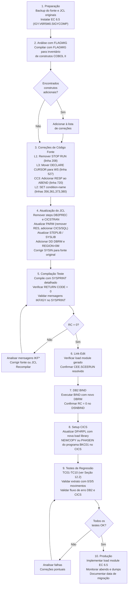

# BKC01 — Guia de Modernização: COBOL II → Enterprise COBOL 6.5

> **Programa:** BKC01 — Consulta de Agência/Conta Bancária  
> **Compilador de origem:** VS COBOL II (`IGYCRCTL` v2.4)  
> **Compilador de destino:** Enterprise COBOL 6.5 (`IGYCRCTL` v6.5)  
> **Complexidade:** 🔴 **Complexa** — CICS + DB2 + construtos incompatíveis  
> **Fontes de referência:**  
> - [`skill-cics-migration.md`](../../Cobol-Skills/skill-cics-migration.md)  
> - [`skill-db2-migration.md`](../../Cobol-Skills/skill-db2-migration.md)  
> - [`skill-compiler-options.md`](../../Cobol-Skills/skill-compiler-options.md)  
> - [`skill-jcl-procedures.md`](../../Cobol-Skills/skill-jcl-procedures.md)  
> - [`skill-le-migration.md`](../../Cobol-Skills/skill-le-migration.md)  
> - [`skill-lang-changes.md`](../../Cobol-Skills/skill-lang-changes.md)

---

## Sumário

1. [Classificação de Complexidade](#1-classificação-de-complexidade)
2. [Visão Geral das Mudanças](#2-visão-geral-das-mudanças)
3. [Categoria 1 — Mudanças de Linguagem](#3-categoria-1--mudanças-de-linguagem)
4. [Categoria 2 — Opções de Compilador](#4-categoria-2--opções-de-compilador)
5. [Categoria 3 — Language Environment](#5-categoria-3--language-environment)
6. [Categoria 4 — Adaptações CICS](#6-categoria-4--adaptações-cics)
7. [Categoria 5 — Adaptações DB2](#7-categoria-5--adaptações-db2)
8. [Categoria 6 — JCL e Procedures](#8-categoria-6--jcl-e-procedures)
9. [Checklist Consolidado de Migração](#9-checklist-consolidado-de-migração)
10. [Código Fonte Corrigido — Trechos Antes/Depois](#10-código-fonte-corrigido--trechos-antesdepois)
11. [JCL Completo Migrado](#11-jcl-completo-migrado)
12. [Estratégia de Teste e Equivalência Funcional](#12-estratégia-de-teste-e-equivalência-funcional)
13. [Sequência de Execução da Migração](#13-sequência-de-execução-da-migração)

---

## 1. Classificação de Complexidade

| Critério | Presente em BKC01 | Impacto |
|---|---|---|
| Programa CICS | ✅ Sim — transação BKQ1, pseudo-conversacional | Alto |
| Acesso DB2 | ✅ Sim — 3 tabelas, 1 cursor | Alto |
| `STOP RUN` em contexto CICS | ✅ Linha 208 | 🔴 Causa abend S0C4 |
| `DECLARE CURSOR` na Procedure Division | ✅ Linha 527 | 🔴 Erro de compilação |
| Step `DFHECP1$` no JCL | ✅ Step CICSTRAN | 🔴 Eliminar |
| Step `DSNHPC` no JCL | ✅ Step DB2PREC | 🔴 Eliminar |
| Opção `RES` no PARM | ✅ Step COBCOMP | 🔴 Erro de compilação |
| `EXEC CICS ABEND` sem `RESP` | ✅ Linha 720 | 🟡 Recomendado corrigir |
| `MOVE 'Y'/'N' TO switch` | ✅ Linhas 356, 361, 373, 380 | 🟡 Prática obsoleta |
| `CALL 'IGZERRE'`/`IGZETUN'` | ❌ Não | Sem impacto |
| `HANDLE CONDITION` | ❌ Não | Sem impacto |
| `CMPR2`, `ALTER`, `STOP literal` | ❌ Não | Sem impacto |

**Resultado:** Classificação **Complexa** — CICS + DB2, itens 🔴 obrigatórios
que, sem correção, resultam em **erro de compilação** ou **abend em runtime**.

---

## 2. Visão Geral das Mudanças

```
COBOL II (antes)                    Enterprise COBOL 6.5 (depois)
══════════════════                  ══════════════════════════════

JCL — 6 steps                  →   JCL — 4 steps
  ASMMAP  (BMS assembly)               ASMMAP  (sem alteração)
  LNKMAP  (BMS link)                   LNKMAP  (sem alteração)
  DB2PREC (DSNHPC)            ──┐
  CICSTRAN (DFHECP1$)         ──┤  →   COBCOMP (compilação única)
  COBCOMP (IGYCRCTL v2.4)     ──┘         CICS integrado (opção CICS)
  LNKPGM  (link-edit)                     DB2  integrado (opção SQL)
                                       LNKPGM  (sem alteração estrutural)

Opções de compilador
  APOST,LIB,RENT,RES,OPT,    →   APOST,LIB,RENT,OPT(FULL),NODYNAM,
  NODYNAM,NODECK                  NODECK,CICS('COBOL2'),SQL,ARCH(10),
                                  TUNE(10),TRUNC(OPT),INVDATA(NOFIXUP),
                                  NUMCHECK,INITCHECK

Runtime library
  COB2.SCOB2LKE               →   CEE.SCEERUN  (Language Environment)

Código fonte — 3 correções obrigatórias
  STOP RUN (linha 208)        →   Remover
  DECLARE CURSOR na ProcDiv   →   Mover para Working-Storage
  ABEND sem RESP (linha 720)  →   Adicionar RESP (recomendado)
```

---

## 3. Categoria 1 — Mudanças de Linguagem

### 3.1 `STOP RUN` após `EXEC CICS RETURN` — 🔴 Obrigatório

**Localização:** [`BKC01.cbl`](../src/BKC01.cbl) linha 208  
**Referência:** [`skill-cics-migration.md`](../../Cobol-Skills/skill-cics-migration.md) §2

#### Por que é crítico

Em COBOL II, `STOP RUN` encerrava o run-unit da task CICS, mas o impacto
era tolerado em cenários onde o código era letra morta após o `RETURN`.

Em **Enterprise COBOL 6.5 + Language Environment**, `STOP RUN` encerra o
**enclave LE inteiro**, o que sob CICS causa:
- Abend `S0C4` (storage violation), ou
- Loop de retorno para o CICS dispatcher com estado indefinido.

#### Análise do código

```cobol
*  Linha 201-208 — BKC01.cbl
           EXEC CICS RETURN
               TRANSID  (WSBK-TRANSID)
               COMMAREA (DFHCOMMAREA)
               LENGTH   (900)
               RESP     (WSBK-CICS-RESP)
           END-EXEC

           STOP RUN.          ← REMOVER
```

O `EXEC CICS RETURN` transfere controle de volta ao CICS dispatcher —
nenhum statement após ele é executado em condições normais. O `STOP RUN`
é código morto em COBOL II também, mas sob LE torna-se perigoso porque
o compilador pode otimizar a sequência de forma diferente.

#### Correção

```cobol
*  DEPOIS — Enterprise COBOL 6.5
           EXEC CICS RETURN
               TRANSID  (WSBK-TRANSID)
               COMMAREA (DFHCOMMAREA)
               LENGTH   (900)
               RESP     (WSBK-CICS-RESP)
           END-EXEC.
*                    ↑ ponto final encerra o parágrafo
*          STOP RUN removido — não necessário em CICS

       000-EXIT.
           EXIT.
```

**Equivalência funcional:** ✅ Garantida — a lógica de negócio não é alterada.

---

### 3.2 `MOVE 'Y'/'N' TO switch` — 🟡 Recomendado

**Localizações:** [`BKC01.cbl`](../src/BKC01.cbl) linhas 356, 361, 373, 380  
**Referência:** [`skill-lang-changes.md`](../../Cobol-Skills/skill-lang-changes.md) §3.3

#### Análise

O parágrafo `420-EDIT-FIELDS` usa o padrão COBOL II de atribuir valores
literais diretamente à variável de controle em vez de usar o idiom ANSI 85
de condition-names (`88`):

```cobol
*  COBOL II — padrão obsoleto (linhas 356, 361, 373, 380)
           MOVE 'Y'           TO WSBK-EDIT-ERROR-SW
```

A Working-Storage já define os condition-names corretamente:

```cobol
           12  WSBK-EDIT-ERROR-SW   PIC X           VALUE 'N'.
               88  WSBK-EDIT-ERROR              VALUE 'Y'.
               88  WSBK-NO-EDIT-ERROR           VALUE 'N'.
```

#### Correção

```cobol
*  DEPOIS — Enterprise COBOL 6.5 (idiom ANSI 85)
           SET WSBK-EDIT-ERROR    TO TRUE   *> equivalente a MOVE 'Y'
           SET WSBK-NO-EDIT-ERROR TO TRUE   *> equivalente a MOVE 'N'
```

**Equivalência funcional:** ✅ Garantida — `SET condition TO TRUE` é
semanticamente idêntico ao `MOVE` do valor correspondente.

---

## 4. Categoria 2 — Opções de Compilador

**Localização:** [`BKJCL01J.jcl`](../jcl/BKJCL01J.jcl) linha 97  
**Referência:** [`skill-compiler-options.md`](../../Cobol-Skills/skill-compiler-options.md)

### 4.1 Mapa Completo de Opções — BKC01

| Opção Original | Status EC 6.5 | Ação | Severidade |
|---|---|---|---|
| `APOST` | Mantida | Sem alteração | ✅ |
| `LIB` | Mantida | Sem alteração | ✅ |
| `RENT` | Mantida (obrigatória para CICS) | Sem alteração | ✅ |
| `RES` | **Removida** em EC 5+ | **Remover** | 🔴 |
| `OPT` (bare) | Substituída por `OPT(FULL)` | Atualizar | 🟡 |
| `NODYNAM` | Mantida | Sem alteração | ✅ |
| `NODECK` | Mantida | Sem alteração | ✅ |
| — | **Nova** | Adicionar `CICS('COBOL2')` | 🔴 |
| — | **Nova** | Adicionar `SQL` | 🔴 |
| — | **Nova** | Adicionar `ARCH(10)` | 🟡 |
| — | **Nova** | Adicionar `TUNE(10)` | 🟡 |
| — | **Nova** | Adicionar `TRUNC(OPT)` | 🟡 |
| — | **Nova** | Adicionar `INVDATA(NOFIXUP)` | 🟡 |
| — | **Nova** | Adicionar `NUMCHECK` | 🟡 |
| — | **Nova** | Adicionar `INITCHECK` | 🟡 |

### 4.2 Detalhamento das Opções Novas

#### `RES` — Remoção obrigatória

A opção `RES` (`RESIDENT`) controlava a localização dos módulos COBOL II
em storage. Em EC 5+, esse comportamento é gerenciado pelo Language
Environment e a opção não existe mais. Sua presença causa:

```
IKFxxxx-E  OPTION RES IS NOT SUPPORTED - IGNORED
```

Em versões mais recentes do compilador, pode causar **erro fatal**.

#### `CICS('COBOL2')` — Translator integrado

Substitui completamente o step `DFHECP1$` do JCL. O subnível `'COBOL2'`
garante compatibilidade com programas escritos no estilo COBOL II.
Sem esta opção, o compilador não processa `EXEC CICS` e gera erro.

#### `SQL` — Coprocessor DB2 integrado

Substitui completamente o step `DSNHPC` do JCL. Sem esta opção, o
compilador não processa `EXEC SQL` e gera erro de sintaxe para cada
statement SQL.

#### `OPT(FULL)` — Otimização completa

A opção `OPT` (bare) de COBOL II ativava nível básico de otimização.
`OPT(FULL)` ativa todas as otimizações disponíveis no compilador EC 6.5,
incluindo propagação de constantes, eliminação de código morto e
otimizações de loop.

#### `ARCH(10)` + `TUNE(10)` — Hardware z14/z15/z16

Instrui o compilador a gerar código de máquina otimizado para o hardware
IBM Z da geração correspondente (10 = z14, 11 = z15, 12 = z16). Ajustar
conforme o hardware de execução do LPAR. Melhora de 30–50% em operações
de string e loops com `ARCH`/`TUNE` adequados.

#### `INVDATA(NOFIXUP)` — Substitui comportamento implícito de `NUMPROC`

`INVDATA(NOFIXUP)` é equivalente ao padrão de COBOL II `NUMPROC(PFD)`:
assume que todos os dados numéricos são válidos e não gera overhead de
correção de sinal em cada acesso. Para migração conservadora, usar
`INVDATA(FIXUP,DECIMAL)` (equivale a `NUMPROC(NOPFD)`) e migrar para
`NOFIXUP` após validação em testes.

### 4.3 PARM Antes e Depois

**Antes (COBOL II):**
```jcl
//COBCOMP  EXEC PGM=IGYCRCTL,
//             PARM='APOST,LIB,RENT,RES,OPT,NODYNAM,NODECK'
```

**Depois (Enterprise COBOL 6.5):**
```jcl
//COBCOMP  EXEC PGM=IGYCRCTL,
//             REGION=0M,
//             PARM=('APOST,LIB,RENT,OPT(FULL),NODYNAM,NODECK',
//             'CICS(''COBOL2''),SQL,ARCH(10),TUNE(10)',
//             'TRUNC(OPT),INVDATA(NOFIXUP),NUMCHECK,INITCHECK')
```

> **Nota sobre `REGION=0M`:** EC 6.5 usa armazenamento **acima da barra
> de 2 GB** durante a compilação. Sem `REGION=0M`, pode ocorrer
> `IGYCB7145-U Insufficient memory` em programas grandes.

---

## 5. Categoria 3 — Language Environment

**Referência:** [`skill-le-migration.md`](../../Cobol-Skills/skill-le-migration.md)

### 5.1 Substituição de Runtime Library

| Componente | COBOL II | Enterprise COBOL 6.5 | Ação |
|---|---|---|---|
| Runtime principal | `COB2.SCOB2LKE` | `CEE.SCEERUN` | Atualizar SYSLIB no link-edit |
| Library COBOL | `COB2.SCOB2LOD` | Incluído em `CEE.SCEERUN` | Remover |
| Compiler dataset | `IGY.V2R4M0.SIGYCOMP` | `IGY.V6R5M0.SIGYCOMP` | Atualizar STEPLIB |
| LE headers | Não necessário | `CEE.SCEEH` | Adicionar ao SYSLIB do compile |

> **Regra crítica:** Nunca misturar `COB2.SCOB2LKE` e `CEE.SCEERUN` na mesma
> concatenação STEPLIB/JOBLIB. A coexistência causa comportamento indefinido
> no gerenciamento de enclave.
> (`skill-le-migration.md` §4)

### 5.2 Chamadas de Runtime — Verificação em BKC01

| Chamada COBOL II | Presente em BKC01 | Ação |
|---|---|---|
| `CALL 'IGZERRE'` | ❌ Não encontrada | Nenhuma |
| `CALL 'IGZETUN'` | ❌ Não encontrada | Nenhuma |
| `CALL 'IGZCLOC'` | ❌ Não encontrada | Nenhuma |
| Opção `RTEREUS` | ❌ Não encontrada | Nenhuma |
| Opção `LIBKEEP` | ❌ Não encontrada | Nenhuma |
| Opção `STAE`/`NOSTAE` | ❌ Não encontrada | Nenhuma |

✅ **BKC01 não utiliza nenhuma chamada de runtime COBOL II.**
O Language Environment é ativado automaticamente quando o programa é
invocado sob CICS — nenhuma mudança de código fonte é necessária para esta categoria.

### 5.3 Diagnóstico — Substituição de Dump

| COBOL II | Enterprise COBOL 6.5 | Observação |
|---|---|---|
| `IGZSNAP` — dump Working-Storage | `CEEDUMP` — dump LE estruturado | BKC01 usa `EXEC CICS DUMP TASK` |
| `IGZDUMP` — dump completo | LE `SYSMDUMP` / `SYSUDUMP` | Mantido pelo CICS |
| `EXEC CICS DUMP TASK` | **Mantido sem alteração** | Código BKD2 continua válido |

O parágrafo `880-DB2-ERROR` de BKC01 usa `EXEC CICS DUMP TASK DUMPCODE('BKD2')` —
este comando permanece válido em EC 6.5 e não requer alteração.

### 5.4 CEEOPTS — Configuração de Runtime LE (Opcional)

Para ambientes CICS, as opções LE são configuradas no CICS **SIT** (System
Initialization Table) via parâmetro `CEEOPT`. Para batch, pode-se usar o
DD `CEEOPTS`:

```jcl
//CEEOPTS  DD *
  TRAP(ON,NOSPIE)
  STORAGE(00,00,00)
  RPTOPTS(ON)
/*
```

BKC01 não requer configuração especial de CEEOPTS para funcionar.

---

## 6. Categoria 4 — Adaptações CICS

**Referência:** [`skill-cics-migration.md`](../../Cobol-Skills/skill-cics-migration.md)

### 6.1 Translator Integrado — Eliminação do Step `DFHECP1$`

Em COBOL II, o processo de compilação de programas CICS exigia um step
separado com o programa `DFHECP1$` antes da compilação COBOL. Este step
convertia cada `EXEC CICS ... END-EXEC` em chamadas ao módulo de interface
CICS (`DFHEIP`).

Em **Enterprise COBOL 6.5**, o translator é integrado ao compilador e
ativado pela opção `CICS`. O resultado funcional é idêntico, mas o processo
é mais simples e menos propenso a erros de sincronização entre o source
original e o output do translator.

```
COBOL II — Pipeline de compilação CICS:
  Fonte Original
      │
      ▼ DFHECP1$ PARM='COBOL2,CICS'
  &&CICSOUT (source traduzido — EXEC CICS → CALL DFHEIP)
      │
      ▼ IGYCRCTL v2.4
  Object Module

Enterprise COBOL 6.5 — Pipeline de compilação CICS:
  Fonte Original
      │
      ▼ IGYCRCTL v6.5 PARM='...CICS(''COBOL2'')...'
        (translator integrado processa EXEC CICS internamente)
  Object Module
```

**Impacto no JCL:**
- Remover step `CICSTRAN` (`PGM=DFHECP1$`) integralmente.
- Remover DD `&&CICSOUT`.
- Mudar `SYSIN` do step `COBCOMP` para apontar ao fonte original.
- Adicionar `CICS('COBOL2')` ao PARM do step `COBCOMP`.

### 6.2 `STOP RUN` — Já coberto na Categoria 1

Ver [Seção 3.1](#31-stop-run-após-exec-cics-return---obrigatório).

### 6.3 `EXEC CICS ABEND` sem `RESP` — 🟡 Recomendado

**Localização:** [`BKC01.cbl`](../src/BKC01.cbl) linha 720

```cobol
*  ANTES — COBOL II (linha 718-722)
       890-CICS-ERROR.

           EXEC CICS ABEND
               ABCODE  (WSBK-ABEND-CODE)
           END-EXEC.
```

Em COBOL II, `EXEC CICS ABEND` sem `RESP` era aceitável porque o CICS
interceptava condições de erro diretamente. Em EC 6.5 com LE, a ausência
de `RESP` pode resultar em condição não tratada se o código de abend for
inválido (ex: código com caracteres não permitidos).

```cobol
*  DEPOIS — Enterprise COBOL 6.5
       890-CICS-ERROR.

           EXEC CICS ABEND
               ABCODE  (WSBK-ABEND-CODE)
               RESP    (WSBK-CICS-RESP)
           END-EXEC.
```

### 6.4 `EXEC CICS HANDLE CONDITION` — Verificação

BKC01 **não utiliza** `EXEC CICS HANDLE CONDITION`. Todos os comandos CICS
já usam o parâmetro `RESP` com verificação subsequente via `IF NOT WSBK-CICS-NORMAL`
— padrão correto para EC 6.5.

### 6.5 CSD e DFHRPL — Setup Pós-Migração

Após recompilar com EC 6.5, o load module de BKC01 terá um formato interno
diferente (gerado pelo integrated translator em vez do `DFHECP1$`). O CSD
e o DFHRPL devem ser atualizados:

| Item | Ação |
|---|---|
| `DFHRPL` | Adicionar nova load library `BANCO.EC65.LOAD` **antes** de `BANCO.CICS.LOAD` |
| CSD — programa `BKC01` | `LANGUAGE(COBOL)` permanece — sem alteração |
| CSD — mapset `BKCONS0` | O mapset BMS não é recompilado — sem alteração |
| Transação `BKQ1` | Sem alteração |

---

## 7. Categoria 5 — Adaptações DB2

**Referência:** [`skill-db2-migration.md`](../../Cobol-Skills/skill-db2-migration.md)

### 7.1 Coprocessor Integrado — Eliminação do Step `DSNHPC`

Em COBOL II, o step `DB2PREC` (`PGM=DSNHPC`) processava os `EXEC SQL` e
gerava o DBRM (Database Request Module) separadamente do código COBOL.

Em **Enterprise COBOL 6.5**, o coprocessor DB2 é integrado ao compilador
via opção `SQL`. O DBRM é gerado diretamente no step de compilação via DD `DBRM`.

```
COBOL II — Pipeline de compilação DB2:
  Fonte Original
      │
      ▼ DSNHPC PARM='HOST(COBOL),VERSION(AUTO),APOSTSQL(YES)'
  &&DB2OUT (source com SQL substituído)   +   BANCO.DBRMLIB(BKC01)
      │
      ▼ (DFHECP1$ opcional)
  &&CICSOUT
      │
      ▼ IGYCRCTL
  Object Module

Enterprise COBOL 6.5 — Pipeline DB2:
  Fonte Original
      │
      ▼ IGYCRCTL PARM='...SQL...'
        (coprocessor integrado processa EXEC SQL internamente)
  Object Module    +   BANCO.DBRMLIB(BKC01)  [via DD DBRM]
```

**Impacto no JCL:**
- Remover step `DB2PREC` (`PGM=DSNHPC`) integralmente.
- Remover DD `SYSCIN` (`&&DB2OUT`).
- Adicionar `SQL` ao PARM do step `COBCOMP`.
- Adicionar DD `DBRM` ao step `COBCOMP`:
  ```jcl
  //DBRM  DD DSN=BANCO.DBRMLIB(BKC01),DISP=SHR
  ```

### 7.2 `DECLARE CURSOR` — Mudança Obrigatória de Localização

**Localização:** [`BKC01.cbl`](../src/BKC01.cbl) linha 527  
**Referência:** [`skill-db2-migration.md`](../../Cobol-Skills/skill-db2-migration.md) §2

Esta é a **mudança de código mais crítica** para programas DB2 migrados
para o coprocessor integrado.

#### Por que é obrigatório

O precompilador `DSNHPC` processava `DECLARE CURSOR` em qualquer posição
porque realizava uma passagem textual antes da compilação COBOL.

O **coprocessor integrado** processa `DECLARE CURSOR` como parte da compilação
COBOL. O compilador só aceita declarações SQL na **Data Division** — qualquer
`DECLARE CURSOR` na Procedure Division causa **erro de compilação**:

```
IGYSC3118-E  A DECLARE CURSOR statement was found in the Procedure Division.
             This statement must appear in the Data Division.
```

#### Análise do código — Localização atual (incorreta)

```cobol
*  PARÁGRAFO 530-READ-EXTRATO — linha 506
       530-READ-EXTRATO.

           MOVE WSBK-COD-AGENCIA          TO EX-COD-AGENCIA
           ...
           EXEC SQL                            ← linha 526
               DECLARE CSREXTRATO CURSOR FOR  ← DEVE SER MOVIDO
               SELECT EX_DAT_MOVIMENTO,
                      ...
               FROM   BANCO.EXTRATO_MOV
               WHERE  EX_COD_AGENCIA = :EX-COD-AGENCIA
               ...
           END-EXEC

           EXEC SQL OPEN CSREXTRATO END-EXEC  ← permanece aqui
```

#### Correção — Mover `DECLARE` para Working-Storage

Na Data Division, logo após o `INCLUDE SQLCA` (linha 146):

```cobol
*  DEPOIS — Working-Storage Section (após linha 146)
      *--- AREA DE SQLCA
           EXEC SQL INCLUDE SQLCA END-EXEC.

      *--- CURSOR DECLARATIONS (EC 6.5: obrigatório na Data Division) ---
           EXEC SQL
               DECLARE CSREXTRATO CURSOR FOR
               SELECT EX_DAT_MOVIMENTO,
                      EX_COD_TIPO_MOV,
                      EX_DES_HISTORICO,
                      EX_VLR_MOVIMENTO,
                      EX_VLR_SALDO_APOS
               FROM   BANCO.EXTRATO_MOV
               WHERE  EX_COD_AGENCIA = :EX-COD-AGENCIA
               AND    EX_NUM_CONTA   = :EX-NUM-CONTA
               AND    EX_DAT_MOVIMENTO >= CURRENT DATE - 5 DAYS
               ORDER  BY EX_DAT_MOVIMENTO DESC,
                         EX_NUM_SEQ      DESC
               FETCH  FIRST 5 ROWS ONLY
           END-EXEC.
```

Na Procedure Division, em `530-READ-EXTRATO`, **remover** o `DECLARE` e
**manter** apenas `OPEN`, `FETCH` e `CLOSE`.

**Equivalência funcional:** ✅ Garantida — `DECLARE CURSOR` é puramente
declarativo. Mover para a Data Division não altera o SQL nem o ciclo
OPEN/FETCH/CLOSE. Requer teste de regressão do fluxo de extrato.

### 7.3 `EXEC SQL INCLUDE` — Sem Alteração

A sintaxe dos `EXEC SQL INCLUDE` para DCLGENs permanece idêntica:

```cobol
*  Ambos COBOL II e Enterprise COBOL 6.5 — mesma sintaxe
           EXEC SQL INCLUDE BKAGCD END-EXEC.
           EXEC SQL INCLUDE BKCTCD END-EXEC.
           EXEC SQL INCLUDE BKEXCD END-EXEC.
           EXEC SQL INCLUDE SQLCA  END-EXEC.
```

O que muda é apenas onde o compilador busca os membros: no JCL, os datasets
DCLGEN devem estar na concatenação `SYSLIB` do step `COBCOMP` (não mais no
`SYSLIB` do step `DSNHPC`). BKC01 já tem `BANCO.DB2.DCLGEN` na SYSLIB do
COBCOMP, então **nenhuma alteração adicional é necessária** para esta parte.

### 7.4 SQLCODE e SQLCA — Sem Alteração

Os códigos SQLCODE (`0`, `100`, outros) e o tratamento via `EVALUATE SQLCODE`
permanecem idênticos. O SQLCA gerado pelo coprocessor integrado é o mesmo
que o gerado pelo DSNHPC.

### 7.5 DB2 BIND — Obrigatório após Recompilação

Após recompilar com EC 6.5, o DBRM gerado pelo coprocessor integrado é um
**novo arquivo**. O BIND anterior (realizado com o DBRM do DSNHPC) deixa de
ser válido para o novo load module. Um re-BIND é obrigatório:

```jcl
//DSNBIND  EXEC PGM=IKJEFT01
//SYSTSPRT DD SYSOUT=*
//SYSTSIN  DD *
  DSN SYSTEM(DB2P)
  BIND PACKAGE(BANCPKG) -
       MEMBER(BKC01)    -
       LIBRARY('BANCO.DBRMLIB') -
       ISOLATION(CS)    -
       VALIDATE(BIND)   -
       ACTION(REPLACE)
  END
/*
```

---

## 8. Categoria 6 — JCL e Procedures

**Referência:** [`skill-jcl-procedures.md`](../../Cobol-Skills/skill-jcl-procedures.md)

### 8.1 Resumo das Alterações no JCL

| Step | Ação | Razão |
|---|---|---|
| `ASMMAP` (BMS Assembly) | ✅ Sem alteração | BMS mapset não depende do compilador COBOL |
| `LNKMAP` (BMS Link) | ✅ Sem alteração | Idem |
| `DB2PREC` (DSNHPC) | 🔴 **Remover completamente** | Substituído por opção `SQL` |
| `CICSTRAN` (DFHECP1$) | 🔴 **Remover completamente** | Substituído por opção `CICS` |
| `COBCOMP` (IGYCRCTL) | 🔴 **Modificar** | PARM, STEPLIB, SYSLIB, SYSIN, DBRM DD, REGION |
| `LNKPGM` (IEWL) | 🔴 **Modificar** | SYSLIB atualizar IGY dataset e COND |

### 8.2 Alterações Detalhadas — Step COBCOMP

| DD / Parâmetro | Antes | Depois | Ação |
|---|---|---|---|
| `EXEC PARM` | `'APOST,LIB,RENT,RES,OPT,NODYNAM,NODECK'` | ver §4.3 | Reescrever |
| `REGION` | (não especificado) | `REGION=0M` | Adicionar |
| `STEPLIB` | `IGY.V2R4M0.SIGYCOMP` | `IGY.V6R5M0.SIGYCOMP` | Atualizar DSN |
| `SYSLIB` — compilador | `BANCO.CICS.COPYLIB`, `BANCO.DB2.DCLGEN`, `CICS.SDFHCOB` | Idem + `CEE.SCEEH` | Adicionar `CEE.SCEEH` |
| `DBRM DD` | Ausente (era no step DSNHPC) | `//DBRM DD DSN=BANCO.DBRMLIB(BKC01),DISP=SHR` | Adicionar |
| `SYSIN` | `DSN=&&CICSOUT,DISP=(OLD,DELETE)` | `DSN=BANCO.CICS.SRC(BKC01),DISP=SHR` | Apontar ao fonte |
| `COND` | `COND=(4,LT)` | `COND=(4,LT,ASMMAP)` | Ajustar referência |

### 8.3 Alterações Detalhadas — Step LNKPGM

| DD / Parâmetro | Antes | Depois | Ação |
|---|---|---|---|
| `COND` | `COND=(4,LT)` | `COND=(4,LT,COBCOMP)` | Referenciar step correto |
| `SYSLIB` — IGY dataset | `IGY.V2R4M0.SIGYCOMP` | `IGY.V6R5M0.SIGYCOMP` | Atualizar DSN |
| `SYSLIB` — `CEE.SCEERUN` | Já presente (linha 127) | Já correto | ✅ Sem alteração |

### 8.4 DDs Intermediárias a Eliminar

| DD | Presente em | Motivo da remoção |
|---|---|---|
| `SYSCIN / &&DB2OUT` | Step DB2PREC | Step removido |
| `&&CICSOUT` | Step CICSTRAN → COBCOMP | Step removido; SYSIN passa ao fonte original |
| `DBRMLIB` | Step DB2PREC | DD DBRM migra para o step COBCOMP |

---

## 9. Checklist Consolidado de Migração

### 9.1 Código Fonte — [`BKC01.cbl`](../src/BKC01.cbl)

```
OBRIGATÓRIO
[ ] L1  Remover STOP RUN (linha 208)
        → Causa abend S0C4 sob Language Environment
[ ] L3  Mover DECLARE CURSOR CSREXTRATO para Working-Storage (linha 527)
        → Erro de compilação com coprocessor integrado (IGYSC3118-E)

RECOMENDADO
[ ] L2  Substituir MOVE 'Y'/'N' TO switch por SET condition-name TO TRUE
        → Linhas 356, 361, 373, 380 do parágrafo 420-EDIT-FIELDS
[ ] CC3 Adicionar RESP à chamada EXEC CICS ABEND (linha 720)
        → Captura erro no próprio ABEND sob EC 6.5
```

### 9.2 JCL — [`BKJCL01J.jcl`](../jcl/BKJCL01J.jcl)

```
OBRIGATÓRIO — STEPS A REMOVER
[ ] J1  Remover step DB2PREC (DSNHPC) completo (linhas 54-68)
[ ] J2  Remover step CICSTRAN (DFHECP1$) completo (linhas 72-91)

OBRIGATÓRIO — STEP COBCOMP
[ ] J3  Remover opção RES do PARM (erro de compilação em EC 5+)
[ ] J4  Adicionar REGION=0M ao EXEC (EC 6.5 usa memória acima de 2GB)
[ ] J5  Atualizar STEPLIB para IGY.V6R5M0.SIGYCOMP
[ ] J6  Adicionar CICS('COBOL2') ao PARM
[ ] J7  Adicionar SQL ao PARM
[ ] J8  Adicionar DD DBRM: DSN=BANCO.DBRMLIB(BKC01)
[ ] J9  Alterar SYSIN para fonte original: DSN=BANCO.CICS.SRC(BKC01)
[ ] J10 Adicionar CEE.SCEEH ao SYSLIB (headers Language Environment)

OBRIGATÓRIO — STEP LNKPGM
[ ] J11 Atualizar SYSLIB de IGY.V2R4M0 para IGY.V6R5M0.SIGYCOMP
[ ] J12 Ajustar COND para referenciar COBCOMP

OBRIGATÓRIO — PÓS-COMPILAÇÃO
[ ] J13 Executar BIND DB2 com novo DBRM gerado pelo coprocessor
[ ] J14 Atualizar DFHRPL para incluir nova load library EC 6.5

RECOMENDADO
[ ] J15 OPT → OPT(FULL)
[ ] J16 Adicionar ARCH(10), TUNE(10)
[ ] J17 Adicionar TRUNC(OPT), INVDATA(NOFIXUP)
[ ] J18 Adicionar NUMCHECK, INITCHECK
```

### 9.3 Language Environment

```
VERIFICAÇÃO — NENHUMA AÇÃO NECESSÁRIA EM BKC01
[x] Nenhuma chamada IGZERRE / IGZETUN / IGZCLOC encontrada
[x] Nenhuma opção RTEREUS / LIBKEEP / STAE / MIXRES encontrada
[x] CEE.SCEERUN já presente no SYSLIB do link-edit (linha 127 do JCL)
[x] EXEC CICS DUMP TASK permanece válido — sem alteração
```

---

## 10. Código Fonte Corrigido — Trechos Antes/Depois

### Correção 1 — Remover `STOP RUN` (linha 208)

```cobol
      *================================================================
      * ANTES — COBOL II (linhas 200-211)
      *================================================================
           EXEC CICS RETURN
               TRANSID  (WSBK-TRANSID)
               COMMAREA (DFHCOMMAREA)
               LENGTH   (900)
               RESP     (WSBK-CICS-RESP)
           END-EXEC

           STOP RUN.          ← REMOVER — abend S0C4 sob LE

       000-EXIT.
           EXIT.

      *================================================================
      * DEPOIS — Enterprise COBOL 6.5
      * Ref: skill-cics-migration.md §2 "STOP RUN"
      *================================================================
           EXEC CICS RETURN
               TRANSID  (WSBK-TRANSID)
               COMMAREA (DFHCOMMAREA)
               LENGTH   (900)
               RESP     (WSBK-CICS-RESP)
           END-EXEC.
      *>> EC65-L1: STOP RUN removido — encerra enclave LE sob CICS

       000-EXIT.
           EXIT.
```

---

### Correção 2 — Mover `DECLARE CURSOR` para Working-Storage

```cobol
      *================================================================
      * ANTES — Working-Storage (linhas 143-146)
      * Não havia DECLARE aqui
      *================================================================
      *--- AREA DE SQLCA
           EXEC SQL
               INCLUDE SQLCA
           END-EXEC.

      *--- COPY BMS DSECT
           COPY BKCON01.

      *================================================================
      * ANTES — Procedure Division (linhas 526-540) — ERRO EM EC 6.5
      *================================================================
       530-READ-EXTRATO.
           ...
           EXEC SQL
               DECLARE CSREXTRATO CURSOR FOR    ← PROIBIDO na Proc. Div.
               SELECT EX_DAT_MOVIMENTO,
                      EX_COD_TIPO_MOV,
                      EX_DES_HISTORICO,
                      EX_VLR_MOVIMENTO,
                      EX_VLR_SALDO_APOS
               FROM   BANCO.EXTRATO_MOV
               WHERE  EX_COD_AGENCIA = :EX-COD-AGENCIA
               AND    EX_NUM_CONTA   = :EX-NUM-CONTA
               AND    EX_DAT_MOVIMENTO >= CURRENT DATE - 5 DAYS
               ORDER  BY EX_DAT_MOVIMENTO DESC,
                         EX_NUM_SEQ      DESC
               FETCH  FIRST 5 ROWS ONLY
           END-EXEC

           EXEC SQL OPEN  CSREXTRATO END-EXEC
           ...

      *================================================================
      * DEPOIS — Working-Storage (após linha 146)
      * Ref: skill-db2-migration.md §2 "DECLARE CURSOR"
      *================================================================
      *--- AREA DE SQLCA
           EXEC SQL INCLUDE SQLCA END-EXEC.

      *--- CURSOR DECLARATIONS — obrigatorio na Data Division (EC 6.5)
      *>>  EC65-L3: movido de 530-READ-EXTRATO (Procedure Division)
      *>>  Ref: skill-db2-migration.md §2
           EXEC SQL
               DECLARE CSREXTRATO CURSOR FOR
               SELECT EX_DAT_MOVIMENTO,
                      EX_COD_TIPO_MOV,
                      EX_DES_HISTORICO,
                      EX_VLR_MOVIMENTO,
                      EX_VLR_SALDO_APOS
               FROM   BANCO.EXTRATO_MOV
               WHERE  EX_COD_AGENCIA = :EX-COD-AGENCIA
               AND    EX_NUM_CONTA   = :EX-NUM-CONTA
               AND    EX_DAT_MOVIMENTO >= CURRENT DATE - 5 DAYS
               ORDER  BY EX_DAT_MOVIMENTO DESC,
                         EX_NUM_SEQ      DESC
               FETCH  FIRST 5 ROWS ONLY
           END-EXEC.

      *--- COPY BMS DSECT
           COPY BKCON01.

      *================================================================
      * DEPOIS — Procedure Division (530-READ-EXTRATO)
      * DECLARE removido — apenas OPEN / FETCH / CLOSE permanecem
      *================================================================
       530-READ-EXTRATO.

           MOVE WSBK-COD-AGENCIA          TO EX-COD-AGENCIA
           MOVE WSBK-NUM-CONTA            TO EX-NUM-CONTA
           MOVE 0                         TO WSBK-EXTRATO-CTR
           ...
      *>>  EC65-L3: DECLARE CSREXTRATO removido deste ponto

           EXEC SQL OPEN  CSREXTRATO END-EXEC
           ...
```

---

### Correção 3 — Adicionar `RESP` ao `EXEC CICS ABEND` (linha 720)

```cobol
      *================================================================
      * ANTES — COBOL II (linhas 718-725)
      *================================================================
       890-CICS-ERROR.

           EXEC CICS ABEND
               ABCODE  (WSBK-ABEND-CODE)
           END-EXEC.                   ← sem RESP

       890-EXIT.
           EXIT.

      *================================================================
      * DEPOIS — Enterprise COBOL 6.5
      * Ref: skill-cics-migration.md §6 "EXEC CICS ABEND"
      *================================================================
       890-CICS-ERROR.

           EXEC CICS ABEND
               ABCODE  (WSBK-ABEND-CODE)
               RESP    (WSBK-CICS-RESP)       *>> EC65-CC3: RESP adicionado
           END-EXEC.

       890-EXIT.
           EXIT.
```

---

### Correção 4 — `MOVE 'Y'` → `SET condition-name` (linhas 356, 361, 373, 380)

```cobol
      *================================================================
      * ANTES — COBOL II (parágrafo 420-EDIT-FIELDS)
      *================================================================
           IF M01AGENL = +0
               MOVE WSBK-CURSOR-ON        TO M01AGENL
               MOVE 'Y'                   TO WSBK-EDIT-ERROR-SW   ← obsoleto
               MOVE DFHBMFSB              TO M01AGENA
           ELSE
               IF M01AGENI = SPACES
                   MOVE WSBK-CURSOR-ON    TO M01AGENL
                   MOVE 'Y'               TO WSBK-EDIT-ERROR-SW   ← obsoleto
                   MOVE DFHBMFSB          TO M01AGENA
               ...

      *================================================================
      * DEPOIS — Enterprise COBOL 6.5 (idiom ANSI 85)
      * Ref: skill-lang-changes.md §3.3
      *================================================================
           IF M01AGENL = +0
               MOVE WSBK-CURSOR-ON        TO M01AGENL
               SET  WSBK-EDIT-ERROR       TO TRUE  *>> EC65-L2: SET
               MOVE DFHBMFSB              TO M01AGENA
           ELSE
               IF M01AGENI = SPACES
                   MOVE WSBK-CURSOR-ON    TO M01AGENL
                   SET  WSBK-EDIT-ERROR   TO TRUE  *>> EC65-L2: SET
                   MOVE DFHBMFSB          TO M01AGENA
               ...
```

---

## 11. JCL Completo Migrado

O JCL original de 6 steps é reduzido a **4 steps** com as seguintes mudanças:

```jcl
//*===============================================================*
//* JCL     : BKJCL01J  (MIGRADO — ENTERPRISE COBOL 6.5)        *
//* SISTEMA : SISTEMA BANCARIO - BKC01                          *
//*                                                              *
//* MUDANCAS EM RELACAO AO JCL ORIGINAL:                        *
//*   - STEP3 DB2PREC  (DSNHPC)    ELIMINADO [J1]               *
//*   - STEP4 CICSTRAN (DFHECP1$)  ELIMINADO [J2]               *
//*   - STEP5 COBCOMP: PARM, STEPLIB, SYSLIB, SYSIN atualizados *
//*   - STEP6 LNKPGM:  STEPLIB atualizado                       *
//*===============================================================*
//BKJCL01J JOB (ACCT),'BKC01 COMPILE EC65',
//             CLASS=A,
//             MSGCLASS=X,
//             MSGLEVEL=(1,1),
//             NOTIFY=&SYSUID
//*
//*------------------------------------------------------------*
//* STEP1 - ASSEMBLY DO MAPSET BMS (SEM ALTERACAO)            *
//*------------------------------------------------------------*
//ASMMAP   EXEC PGM=ASMA90,
//             PARM='DECK,NOOBJECT'
//SYSLIB    DD DSN=SYS1.MACLIB,DISP=SHR
//          DD DSN=CICS.SDFHMAC,DISP=SHR
//SYSUT1    DD UNIT=SYSDA,SPACE=(CYL,(1,1))
//SYSUT2    DD UNIT=SYSDA,SPACE=(CYL,(1,1))
//SYSUT3    DD UNIT=SYSDA,SPACE=(CYL,(1,1))
//SYSPUNCH  DD DSN=&&MAPOBJ,
//             DISP=(NEW,PASS),
//             UNIT=SYSDA,
//             SPACE=(TRK,(5,2))
//SYSPRINT  DD SYSOUT=*
//SYSIN     DD DSN=BANCO.CICS.MAPS(BKCONS0),DISP=SHR
//*
//*------------------------------------------------------------*
//* STEP2 - LINK DO MAPSET BMS (SEM ALTERACAO)                *
//*------------------------------------------------------------*
//LNKMAP   EXEC PGM=IEWL,
//             PARM='LIST,LET,XREF',
//             COND=(4,LT,ASMMAP)
//SYSLIB    DD DSN=CICS.SDFHLOAD,DISP=SHR
//SYSUT1    DD UNIT=SYSDA,SPACE=(CYL,(1,1))
//SYSPRINT  DD SYSOUT=*
//SYSLMOD   DD DSN=BANCO.CICS.LOAD(BKCONS0),DISP=SHR
//SYSLIN    DD DSN=&&MAPOBJ,DISP=(OLD,DELETE)
//          DD DDNAME=SYSIN
//SYSIN     DD *
 NAME BKCONS0(R)
//*
//*------------------------------------------------------------*
//* STEP3 - COMPILACAO ENTERPRISE COBOL 6.5                   *
//*                                                            *
//* MUDANCAS:                                                  *
//*   [J1] DSNHPC  (DB2PREC)  ELIMINADO — OPCAO SQL INTEGRADA *
//*   [J2] DFHECP1$(CICSTRAN) ELIMINADO — OPCAO CICS INTEGRADA*
//*   [J3] RES REMOVIDO — nao suportado em EC 5+              *
//*   [J4] REGION=0M ADICIONADO — EC 6.5 usa memoria >2GB    *
//*   [J5] STEPLIB ATUALIZADO — IGY.V6R5M0.SIGYCOMP           *
//*   [J6] OPCAO CICS('COBOL2') ADICIONADA                    *
//*   [J7] OPCAO SQL ADICIONADA                               *
//*   [J8] DD DBRM ADICIONADA — saida do coprocessor DB2      *
//*   [J9] SYSIN APONTA PARA FONTE ORIGINAL                   *
//*   [J10] CEE.SCEEH ADICIONADO AO SYSLIB                    *
//*   [J15-J18] OPT(FULL), ARCH, TUNE, INVDATA, NUMCHECK      *
//*------------------------------------------------------------*
//COBCOMP  EXEC PGM=IGYCRCTL,
//             REGION=0M,
//             PARM=('APOST,LIB,RENT,OPT(FULL),NODYNAM,NODECK',
//             'CICS(''COBOL2''),SQL,ARCH(10),TUNE(10)',
//             'TRUNC(OPT),INVDATA(NOFIXUP),NUMCHECK,INITCHECK'),
//             COND=(4,LT,ASMMAP)
//STEPLIB   DD DSN=IGY.V6R5M0.SIGYCOMP,DISP=SHR
//*                  ^^^^^^^^^ [J5] atualizado de V2R4M0
//SYSLIB    DD DSN=BANCO.CICS.COPYLIB,DISP=SHR
//          DD DSN=BANCO.DB2.DCLGEN,DISP=SHR
//          DD DSN=CICS.SDFHCOB,DISP=SHR
//          DD DSN=CEE.SCEEH,DISP=SHR
//*                ^^^^^^^^^ [J10] headers Language Environment
//SYSUT1    DD UNIT=SYSDA,SPACE=(CYL,(2,1))
//SYSUT2    DD UNIT=SYSDA,SPACE=(CYL,(2,1))
//SYSUT3    DD UNIT=SYSDA,SPACE=(CYL,(2,1))
//SYSUT4    DD UNIT=SYSDA,SPACE=(CYL,(2,1))
//SYSUT5    DD UNIT=SYSDA,SPACE=(CYL,(2,1))
//SYSUT6    DD UNIT=SYSDA,SPACE=(CYL,(2,1))
//SYSUT7    DD UNIT=SYSDA,SPACE=(CYL,(2,1))
//SYSPRINT  DD SYSOUT=*
//SYSLIN    DD DSN=&&COBOUT,
//             DISP=(NEW,PASS),
//             UNIT=SYSDA,
//             SPACE=(TRK,(15,5))
//DBRM      DD DSN=BANCO.DBRMLIB(BKC01),DISP=SHR
//*         ^^^^ [J8] NOVO — saida do coprocessor DB2 integrado
//SYSIN     DD DSN=BANCO.CICS.SRC(BKC01),DISP=SHR
//*         ^^^^ [J9] fonte original (antes era &&CICSOUT)
//*
//*------------------------------------------------------------*
//* STEP4 - LINK-EDIT DO PROGRAMA                             *
//*                                                            *
//* MUDANCAS:                                                  *
//*   [J11] SYSLIB IGY.V6R5M0.SIGYCOMP (atualizado)           *
//*   [J12] COND=(4,LT,COBCOMP)                               *
//*   CEE.SCEERUN ja estava presente — sem alteracao           *
//*------------------------------------------------------------*
//LNKPGM   EXEC PGM=IEWL,
//             PARM='LIST,LET,XREF,RENT,REUS',
//             COND=(4,LT,COBCOMP)
//*                     ^^^^^^^ [J12] referencia ao step correto
//SYSLIB    DD DSN=CICS.SDFHLOAD,DISP=SHR
//          DD DSN=DSN.SDSNEXIT,DISP=SHR
//          DD DSN=DSN.SDSNLOAD,DISP=SHR
//          DD DSN=IGY.V6R5M0.SIGYCOMP,DISP=SHR
//*                 ^^^^^^^^^ [J11] atualizado de V2R4M0
//          DD DSN=CEE.SCEERUN,DISP=SHR
//*                ^^^^^^^^^^^ Language Environment runtime — ja correto
//SYSUT1    DD UNIT=SYSDA,SPACE=(CYL,(2,1))
//SYSPRINT  DD SYSOUT=*
//SYSLMOD   DD DSN=BANCO.CICS.LOAD(BKC01),DISP=SHR
//SYSLIN    DD DSN=&&COBOUT,DISP=(OLD,DELETE)
//          DD DDNAME=SYSIN
//SYSIN     DD *
 NAME BKC01(R)
//*===============================================================*
//* FIM DO JCL BKJCL01J — ENTERPRISE COBOL 6.5                 *
//*===============================================================*
```

---

## 12. Estratégia de Teste e Equivalência Funcional

### 12.1 Matriz de Equivalência por Correção

| Correção | Equivalência Funcional | Teste Necessário |
|---|---|---|
| L1 — Remover `STOP RUN` | ✅ Garantida — código morto em COBOL II também | Teste de regressão do fluxo principal |
| L2 — `SET` em vez de `MOVE 'Y'` | ✅ Garantida — semântica idêntica ao `MOVE` do valor 88 | Não específico — coberto pelo teste geral |
| L3 — Mover `DECLARE CURSOR` | ✅ Garantida — `DECLARE` é puramente declarativo | 🔴 Testar fluxo de extrato de 0 a 5 movimentos |
| C1 — Remover `RES` | ✅ Garantida — LE gerencia residência automaticamente | Não específico |
| C3 — Adicionar `CICS` | ✅ Garantida com subopcão `'COBOL2'` | Teste end-to-end da transação BKQ1 |
| C4 — Adicionar `SQL` | ✅ Garantida — coprocessor equivalente ao DSNHPC | Testar todos os 3 acessos SQL |
| CC3 — `RESP` no ABEND | ✅ Garantida — adiciona captura de erro sem alterar lógica | Simular condição de erro |
| J13 — Re-BIND DB2 | ⚠️ Planos de execução podem mudar | 🔴 Testar performance de SQL + resultados |

### 12.2 Casos de Teste Recomendados

| # | Cenário | Dados | Resultado Esperado |
|---|---|---|---|
| TC01 | Primeiro acesso à transação BKQ1 | COMMAREA vazia | Tela inicial em branco, cursor em M01AGEN |
| TC02 | ENTER com agência e conta em branco | Campos vazios | Mensagem 'EDIT ERROR DETECTED', campos em brilho |
| TC03 | ENTER com agência inexistente | Agência `9999` | Mensagem 'AGENCIA NAO ENCONTRADA' |
| TC04 | ENTER com agência válida, conta inexistente | Agência `0001`, conta `9999999999` | Mensagem 'CONTA NAO ENCONTRADA' |
| TC05 | Consulta completa — extrato com 5 movimentos | Dados completos | Nome, tipo, saldo, 5 linhas de extrato |
| TC06 | Consulta completa — extrato com 0 movimentos | Conta sem movimentos em 5 dias | Dados da conta, linhas de extrato em branco |
| TC07 | Consulta completa — extrato com 3 movimentos | Conta com 3 movimentos | 3 linhas preenchidas, 2 linhas em branco |
| TC08 | PF7 — limpar tela | Qualquer estado | Tela limpa, cursor em M01AGEN |
| TC09 | PF3 — retornar ao menu | Qualquer estado | XCTL para BKMEN01 |
| TC10 | Tecla inválida | PF1, PF2, etc. | Mensagem 'TECLA INVALIDA - USE ENTER/PF3/PF7' |

### 12.3 Ferramentas de Diagnóstico

| Ferramenta | Uso |
|---|---|
| `FLAGMIG` (opção do compilador) | Identifica construtos COBOL II incompatíveis antes da migração |
| `NUMCHECK` | Detecta dados numéricos inválidos em tempo de compilação |
| `INITCHECK` | Detecta variáveis não inicializadas |
| Dump CICS código `BKD2` | Diagnóstico de erros DB2 em runtime |
| Abend `BK01` | Diagnóstico de erros CICS em runtime |
| `CEEDUMP` / LE dump | Diagnóstico de exceções LE em runtime |

---

## 13. Sequência de Execução da Migração



---

*Documentação de modernização gerada a partir da análise dos fontes:*
*[`BKC01.cbl`](../src/BKC01.cbl), [`BKJCL01J.jcl`](../jcl/BKJCL01J.jcl)*  
*e das referências de skill:*
*[`skill-cics-migration.md`](../../Cobol-Skills/skill-cics-migration.md),*
*[`skill-db2-migration.md`](../../Cobol-Skills/skill-db2-migration.md),*
*[`skill-compiler-options.md`](../../Cobol-Skills/skill-compiler-options.md),*
*[`skill-jcl-procedures.md`](../../Cobol-Skills/skill-jcl-procedures.md),*
*[`skill-le-migration.md`](../../Cobol-Skills/skill-le-migration.md),*
*[`skill-lang-changes.md`](../../Cobol-Skills/skill-lang-changes.md)*
